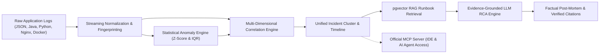
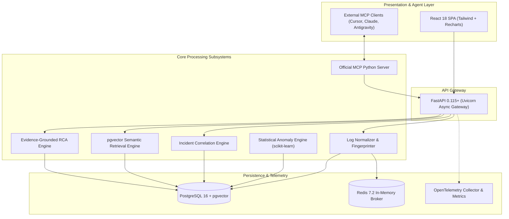

<p align="center">
  
</p>

<h1 align="center">TraceMind AI</h1>

<p align="center">
  <strong>An AI-powered incident intelligence platform that analyses application logs, detects anomalies, correlates errors, and assists engineers in identifying potential root causes of production incidents.</strong>
</p>

<p align="center">
  <a href="https://github.com/anmolvishvas/TraceMind-AI/actions/workflows/ci.yml"></a>
  <a href="https://www.python.org/downloads/release/python-3120/"></a>
  <a href="https://fastapi.tiangolo.com/"></a>
  <a href="https://www.postgresql.org/"></a>
  <a href="https://redis.io/"></a>
  <a href="https://modelcontextprotocol.io/"></a>
  <a href="https://github.com/astral-sh/ruff"></a>
  <a href="https://mypy-lang.org/"></a>
  <a href="https://docs.pytest.org/"></a>
  <a href="LICENSE"></a>
</p>

---

## 📑 Core Engineering Documentation

The foundational architecture, requirements, engineering rulebook, and roadmap are detailed in the following documents:

| Document | Purpose & Description |
| :--- | :--- |
| **[PRD.md](docs/PRD.md)** | **Product Requirements Document:** Vision, personas, user journeys, functional & non-functional requirements, acceptance criteria, and KPIs. |
| **[ARCHITECTURE.md](docs/ARCHITECTURE.md)** | **System Architecture Blueprint:** Detailed Mermaid diagrams, subsystem boundaries, canonical schemas, tech stack trade-offs, and monorepo layout. |
| **[RULES.md](docs/RULES.md)** | **AI & Developer Engineering Rulebook:** Mandatory standards for Python 3.12, typing, async I/O, log parsing, RAG citations, statistical independence, security, and testing. |
| **[DESIGN.md](docs/DESIGN.md)** | **UI/UX Specification & Design System:** Enterprise dark-mode design tokens, telemetry palettes, component anatomy, and 14 application screen layouts. |
| **[TASKS.md](docs/TASKS.md)** | **Phased Implementation Roadmap:** 7 implementation phases with granular, testable tasks and acceptance criteria. |
| **[MEMORY.md](docs/MEMORY.md)** | **Living Project Journal & ADRs:** Project status, known constraints, and Architectural Decision Records (ADR-001 through ADR-008). |

---

## 💡 The Problem

Modern distributed applications generate terabytes of application logs, exceptions, and operational telemetry. When high-severity production incidents occur:
1. **Engineers are overwhelmed by alert noise:** Thousands of cascading errors across decoupled microservices obscure the initial trigger event.
2. **Investigation is slow and manual:** Engineers manually search through logs, grep error patterns, and reconstruct failure timelines under intense operational pressure.
3. **Institutional knowledge is lost:** Teams repeatedly investigate recurring issues because past incident reports, post-mortems, and runbooks are trapped in siloed repositories.
4. **Generic AI tools hallucinate:** Raw log dumps fed into standard LLMs often lead to fabricated root causes, invented error codes, and unsafe remediation recommendations.

---

## 🚀 The Solution: TraceMind AI

**TraceMind AI** transforms raw operational telemetry into verified, evidence-grounded incident intelligence.



### Key Capabilities
- **Multi-Format Log Normalization:** High-throughput streaming ingestion parsing JSON, Python logging, Log4j/Logback Java stack traces, Nginx, and Docker containers into canonical `LogEvent` records.
- **Statistical Anomaly Detection (100% Non-LLM):** Computes rolling 7-day baselines, modified Z-scores ($> 3\sigma$), and Interquartile Range (IQR) bursts via Python (`scikit-learn` / `numpy`) with zero LLM dependence.
- **Multi-Dimensional Incident Correlation:** Automatically clusters cascading errors into cohesive incidents using sliding temporal burst windows, distributed trace IDs, and service topology graphs.
- **Evidence-First Root Cause Analysis (RCA):** Generates structured root cause hypotheses with **mandatory database citations** (`event_id` verification). Unverified claims are prohibited.
- **RAG-Powered Runbook & Historical Post-Mortem Search:** Vector similarity search using PostgreSQL + `pgvector` (HNSW cosine distance) to retrieve past resolutions and troubleshooting runbooks.
- **Official Model Context Protocol (MCP) Server:** Exposes 10 strongly typed, read-only operational tools over STDIO and SSE for seamless integration with AI coding assistants (Cursor, Claude Desktop, Antigravity).
- **Human-in-the-Loop Safety:** Prohibits automated incident resolution and requires human operator sign-off before executing remediation recommendations.

---

## 🛠️ Technology Stack

| Layer | Selected Technologies | Rationale |
| :--- | :--- | :--- |
| **Backend & Language** | Python 3.12+, FastAPI, Pydantic v2 | High-performance asynchronous API framework, strict runtime schema validation, automatic OpenAPI specs. |
| **Database & Vector Store** | PostgreSQL 16 + `pgvector` | Unified ACID relational persistence and HNSW vector similarity search in a single engine. |
| **In-Memory Cache & Broker** | Redis 7.2 (Alpine) | Atomic rolling metric counters for sliding windows, distributed locking, and task queue broker. |
| **ORM & Migrations** | SQLAlchemy 2.0 (asyncpg), Alembic | Modern asynchronous declarative ORM with strict typing. |
| **AI & Embeddings** | OpenAI API (`text-embedding-3-small`, GPT-4o) | High-density semantic search embeddings and structured JSON root cause reasoning. |
| **Anomaly Detection & ML** | Scikit-learn, NumPy, SciPy | Deterministic statistical models (Z-score, IQR, Isolation Forest) independent from LLMs. |
| **External Agent Integration**| Official Anthropic MCP Python SDK | Model Context Protocol implementation for external AI client interoperability. |
| **Observability** | OpenTelemetry SDK, Prometheus, JSON Logging | End-to-end distributed tracing, metrics exposition at `/metrics`, and structured audit logs. |
| **Frontend** | React 18, TypeScript, Tailwind CSS, Recharts | Enterprise-grade dark-mode telemetry dashboard and interactive incident timeline visualizations. |
| **Infrastructure & Quality** | Docker, Docker Compose, Pytest, Ruff, mypy | Multi-stage containerization, strict linting, strict typing, and automated testing ($\ge 90\%$ coverage). |

---

## 🏗️ Architecture Overview

TraceMind AI enforces a clean separation of concerns across presentation, API, domain processing, asynchronous worker, and persistence layers:



For complete technical specifications, see **[docs/ARCHITECTURE.md](docs/ARCHITECTURE.md)**.

---

## ⚡ Quick Start with Docker Compose

TraceMind AI is fully containerized. You can launch the entire stack (PostgreSQL + pgvector, Redis, FastAPI backend, and React frontend) with a single command:

### 1. Prerequisites
- Docker Engine $\ge 24.0$
- Docker Compose $\ge 2.20$
- Git

### 2. Clone the Repository
```bash
git clone https://github.com/anmolvishvas/TraceMind-AI.git
cd TraceMind-AI
```

### 3. Configure Environment Variables
Copy the sample environment file:
```bash
cp .env.example .env
```
Edit `.env` to set your credentials (e.g., `OPENAI_API_KEY`):
```env
ENVIRONMENT=development
POSTGRES_USER=tracemind
POSTGRES_PASSWORD=tracemind_secret
POSTGRES_DB=tracemind_db
POSTGRES_HOST=postgres
POSTGRES_PORT=5432
REDIS_URL=redis://redis:6379/0
OPENAI_API_KEY=your_openai_api_key_here
```

### 4. Build and Start Services
```bash
docker compose up --build -d
```

### 5. Verify Service Health
```bash
# Check service status
docker compose ps

# Test backend health endpoint
curl http://localhost:8000/healthz
```

| Service | URL / Port | Purpose |
| :--- | :--- | :--- |
| **Frontend Dashboard** | [http://localhost:3000](http://localhost:3000) | Web UI & Incident Command Center |
| **FastAPI REST API** | [http://localhost:8000](http://localhost:8000) | Core Application API |
| **Interactive API Docs** | [http://localhost:8000/docs](http://localhost:8000/docs) | Swagger / OpenAPI UI |
| **Prometheus Metrics** | [http://localhost:8000/metrics](http://localhost:8000/metrics) | Telemetry & Observability Exporter |
| **PostgreSQL + pgvector** | `localhost:5432` | Relational & Vector Persistence |
| **Redis Broker** | `localhost:6379` | In-Memory Cache & Task Queue |

---

## 💻 Local Development Setup

To run TraceMind AI natively without Docker:

### Backend Setup (Python 3.12+)
```bash
# Navigate to backend directory
cd backend

# Create and activate virtual environment
python -m venv .venv
# On Windows:
.venv\Scripts\activate
# On Linux/macOS:
# source .venv/bin/activate

# Install dependencies in editable mode with development tools
pip install --upgrade pip
pip install -e ".[dev]"

# Run database migrations
alembic upgrade head

# Start FastAPI development server
uvicorn app.main:app --host 0.0.0.0 --port 8000 --reload
```

### Frontend Setup (Node.js 20+)
```bash
# Navigate to frontend directory
cd frontend

# Install dependencies
npm install

# Start Vite development server
npm run dev
```

---

## 🤖 Model Context Protocol (MCP) Integration

TraceMind AI bundles an official MCP server adhering to the Model Context Protocol specification. External AI agents (e.g., Cursor, Claude Desktop, Antigravity) can connect via STDIO or SSE to query incident intelligence directly.

### Connecting via Claude Desktop / Cursor
Add the following snippet to your `claude_desktop_config.json` or Cursor MCP settings:

```json
{
  "mcpServers": {
    "tracemind-ai": {
      "command": "python",
      "args": ["-m", "app.mcp.server"],
      "cwd": "/path/to/TraceMind-AI/backend",
      "env": {
        "POSTGRES_HOST": "localhost",
        "POSTGRES_PORT": "5432",
        "POSTGRES_USER": "tracemind",
        "POSTGRES_PASSWORD": "tracemind_secret",
        "POSTGRES_DB": "tracemind_db",
        "REDIS_URL": "redis://localhost:6379/0"
      }
    }
  }
}
```

### Available MCP Tools
- `search_logs(service_name, query, severity, limit)`: Search normalized logs with filtering.
- `get_log_details(event_id)`: Retrieve full canonical log event details by UUID.
- `analyse_error_pattern(service_name, timeframe)`: Aggregate stack trace signatures and error counts.
- `detect_anomalies(service_name, timeframe)`: Query statistical anomalies and Z-scores.
- `get_incident_details(incident_id)`: Retrieve incident metadata, impacted services, and state.
- `get_incident_timeline(incident_id)`: Retrieve chronological milestone event timeline.
- `find_related_incidents(incident_id)`: Find correlated incidents by trace ID or topology.
- `search_historical_incidents(query, limit)`: Semantic vector search across past post-mortems.
- `get_service_health(service_name)`: Retrieve current error rates and active incident counts.
- `generate_incident_report(incident_id)`: Trigger on-demand generation of a structured post-mortem.

---

## 🧪 Testing and Quality Assurance

TraceMind AI enforces a minimum **90% branch and line coverage** policy across the backend codebase.

```bash
cd backend

# Run Ruff linting and formatting checks
ruff check .
ruff format --check .

# Run strict mypy type checking
mypy app

# Run full test suite with coverage enforcement
pytest --cov=app --cov-report=term-missing --cov-fail-under=90

# Run static security audit
bandit -r app/

# Run dependency vulnerability audit
pip-audit
```

---

## 🛡️ Security & Privacy Guardrails

- **PII & Secret Scrubbing:** Regular expression filters automatically redact credit card numbers, JWT tokens, AWS access keys, and passwords before persistence.
- **Untrusted Log Prompt Defense:** Operational logs injected into LLM reasoning prompts are strictly isolated within `<untrusted_operational_logs>` delimiter boundaries with explicit anti-injection system directives.
- **Zero Automated Actions:** The platform cannot execute destructive commands or mark incidents as `RESOLVED` without explicit human operator verification.
- **Least-Privilege Containerization:** Production Docker containers execute under a non-root `appuser` with read-only root filesystems where applicable.

---

## 🗺️ Project Roadmap

- [x] **Foundation Architecture & CI/CD Pipeline** (Current Release)
- [ ] **Phase 1:** Core Scaffolding, Async Database Pool & Pydantic Settings
- [ ] **Phase 2:** Multi-format Streaming Log Parser & Error Signature Hashing
- [ ] **Phase 3:** Pure-Python Statistical Anomaly Engine & Multi-Dimensional Correlation
- [ ] **Phase 4:** pgvector RAG Runbook Store & Evidence-Grounded LLM RCA
- [ ] **Phase 5:** Official Model Context Protocol (MCP) Python Server
- [ ] **Phase 6:** React 18 Telemetry Dashboard & Interactive Timeline Workspace
- [ ] **Phase 7:** Production Hardening, Large-file Benchmarking & Turnkey Demo Dataset

---

## 👤 Author & Attribution

- **Architect & Author:** **Anmol Vishvas**
- **Email:** [anmol23vishvas@gmail.com](mailto:anmol23vishvas@gmail.com)
- **GitHub:** [@anmolvishvas](https://github.com/anmolvishvas)
- **Repository:** [https://github.com/anmolvishvas/TraceMind-AI](https://github.com/anmolvishvas/TraceMind-AI)

---

## 📄 License

This project is licensed under the Apache License, Version 2.0. See the [LICENSE](LICENSE) file for details.
