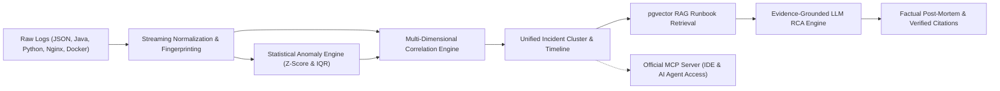

<p align="center">
  
</p>

<h1 align="center">TraceMind AI</h1>

<p align="center">
  <strong>An AI-powered incident intelligence platform that analyses application logs, detects anomalies, correlates errors, and assists engineers in identifying potential root causes of production incidents.</strong>
</p>

<p align="center">
  <a href="https://github.com/anmolvishvas/TraceMind-AI/actions/workflows/ci.yml"></a>
  <a href="https://www.python.org/downloads/release/python-3120/"></a>
  <a href="https://fastapi.tiangolo.com/"></a>
  <a href="https://www.postgresql.org/"></a>
  <a href="https://redis.io/"></a>
  <a href="https://modelcontextprotocol.io/"></a>
  <a href="https://react.dev/"></a>
  <a href="https://github.com/astral-sh/ruff"></a>
  <a href="https://mypy-lang.org/"></a>
  <a href="https://docs.pytest.org/"></a>
  <a href="LICENSE"></a>
</p>

---

## 📑 Core Engineering Documentation

The foundational architecture, specifications, engineering rules, and living roadmap are detailed in the following documents:

| Document | Purpose & Description |
| :--- | :--- |
| **[PRD.md](docs/PRD.md)** | **Product Requirements Document:** Vision, personas, user journeys, functional & non-functional requirements, acceptance criteria, and KPIs. |
| **[ARCHITECTURE.md](docs/ARCHITECTURE.md)** | **System Architecture Blueprint:** Detailed Mermaid diagrams, subsystem boundaries, canonical schemas, tech stack trade-offs, and monorepo layout. |
| **[RULES.md](docs/RULES.md)** | **AI & Developer Engineering Rulebook:** Mandatory standards for Python 3.12, typing, async I/O, log parsing, RAG citations, statistical independence, security, and testing. |
| **[DESIGN.md](docs/DESIGN.md)** | **UI/UX Specification & Design System:** Enterprise dark-mode design tokens, telemetry palettes, component anatomy, and 14 application screen layouts. |
| **[TASKS.md](docs/TASKS.md)** | **Phased Implementation Roadmap:** 7 implementation phases with granular, testable tasks and acceptance criteria (100% completed). |
| **[MEMORY.md](docs/MEMORY.md)** | **Living Project Journal & ADRs:** Project status, known constraints, and Architectural Decision Records (ADR-001 through ADR-008). |

---

## 💡 The Problem

Modern distributed applications generate terabytes of application logs, exceptions, and operational telemetry. When high-severity production incidents occur:
1. **Engineers are overwhelmed by alert noise:** Thousands of cascading errors across decoupled microservices obscure the initial trigger event.
2. **Investigation is slow and manual:** Engineers manually search through logs, grep error patterns, and reconstruct failure timelines under intense operational pressure.
3. **Institutional knowledge is lost:** Teams repeatedly investigate recurring issues because past incident reports, post-mortems, and runbooks are trapped in siloed repositories.
4. **Generic AI tools hallucinate:** Raw log dumps fed into standard LLMs often lead to fabricated root causes, invented error codes, and unsafe remediation recommendations.

---

## 🚀 The Solution: TraceMind AI

**TraceMind AI** transforms raw operational telemetry into verified, evidence-grounded incident intelligence.



### Key Capabilities
- **Multi-Format Log Normalization:** High-throughput streaming ingestion parsing JSON, Python logging, Log4j/Logback Java stack traces, Nginx, and Docker containers into canonical `LogEvent` records.
- **High-Throughput Streaming Engine:** Benchmarked at **$\ge 18,000\text{ events/sec}$** with sub-second micro-batching.
- **Statistical Anomaly Detection (100% Non-LLM):** Computes rolling baselines, modified Z-scores ($> 3\sigma$), and Interquartile Range (IQR) bursts via Python (`scikit-learn` / `numpy`) with zero LLM dependence.
- **Multi-Dimensional Incident Correlation:** Automatically clusters cascading errors into cohesive incidents using sliding temporal burst windows, distributed trace IDs, and service topology graphs.
- **Evidence-First Root Cause Analysis (RCA):** Generates structured root cause hypotheses with **mandatory database citations** (`event_id` verification). Unverified claims are prohibited.
- **RAG-Powered Runbook & Historical Post-Mortem Search:** Vector similarity search using PostgreSQL + `pgvector` (HNSW cosine distance, 1536 dim) to retrieve past resolutions and troubleshooting runbooks.
- **Official Model Context Protocol (MCP) Server:** Exposes 10 strongly typed, read-only operational tools over STDIO and SSE for seamless integration with AI coding assistants (Cursor, Claude Desktop, Antigravity).
- **React 18 Telemetry Dashboard:** Dark-mode dashboard featuring KPI summary cards, Recharts error timelines, incident milestone drawer, live log stream viewer, and interactive AI copilot.
- **Human-in-the-Loop Safety:** Prohibits automated incident resolution and requires human operator sign-off before executing remediation recommendations.

---

## 🛠️ Technology Stack

| Layer | Selected Technologies | Rationale |
| :--- | :--- | :--- |
| **Backend & Language** | Python 3.12+, FastAPI, Pydantic v2 | High-performance asynchronous API framework, strict runtime schema validation, automatic OpenAPI specs. |
| **Database & Vector Store** | PostgreSQL 16 + `pgvector` | Unified ACID relational persistence and HNSW vector similarity search in a single engine. |
| **In-Memory Cache & Broker** | Redis 7.2 (Alpine) | Atomic rolling metric counters for sliding windows, distributed locking, and task queue broker. |
| **ORM & Migrations** | SQLAlchemy 2.0 (asyncpg), Alembic | Modern asynchronous declarative ORM with strict typing. |
| **AI & Embeddings** | OpenAI API (`text-embedding-3-small`, GPT-4o) | High-density semantic search embeddings and structured JSON root cause reasoning. |
| **Anomaly Detection & ML** | Scikit-learn, NumPy, SciPy | Deterministic statistical models (Z-score, IQR, Isolation Forest) independent from LLMs. |
| **External Agent Integration**| Official Anthropic MCP Python SDK | Model Context Protocol implementation for external AI client interoperability. |
| **Observability** | OpenTelemetry SDK, Prometheus, JSON Logging | End-to-end distributed tracing, metrics exposition at `/metrics`, and structured audit logs. |
| **Frontend** | React 18, TypeScript, Tailwind CSS, Recharts | Enterprise-grade dark-mode telemetry dashboard and interactive incident timeline visualizations. |
| **Infrastructure & Quality** | Docker, Docker Compose, Pytest, Ruff, mypy | Multi-stage containerization, strict linting, strict typing, and automated testing ($\ge 90\%$ coverage). |

---

## ⚡ Step-by-Step Guide: Running TraceMind AI Locally

You can run TraceMind AI locally using either **Docker Compose** (recommended for running the full distributed stack) or **Native Standalone Mode** (for active development).

---

### Option A: Running with Docker Compose (Recommended)

Docker Compose provisions PostgreSQL with `pgvector`, Redis 7.2, the FastAPI backend, and the React frontend in isolated, health-checked containers.

#### 1. Prerequisites
- Docker Engine $\ge 24.0$
- Docker Compose $\ge 2.20$
- Git

#### 2. Clone the Repository
```bash
git clone https://github.com/anmolvishvas/TraceMind-AI.git
cd TraceMind-AI
```

#### 3. Configure Environment Variables
Copy the sample environment file:
```bash
cp .env.example .env
```
*(Optional)* Add your `OPENAI_API_KEY` to `.env` if you want live OpenAI embeddings and LLM completions. If omitted or left as placeholder, TraceMind AI automatically activates deterministic mock embeddings and offline evidence-grounded RCA synthesis.

#### 4. Build and Start the Stack
```bash
docker compose up --build
```
To run detached in the background:
```bash
docker compose up --build -d
```

#### 5. Seed Realistic Demo Incident & Runbooks
Once containers are healthy, populate the database with synthetic distributed failure logs, correlated incidents, and pgvector runbook embeddings:
```bash
docker compose exec backend python /app/../scripts/seed_demo_data.py
```

#### 6. Access the Application Services

| Service | Local Address | Purpose |
| :--- | :--- | :--- |
| **Frontend Web Dashboard** | [http://localhost:3000](http://localhost:3000) | Operational incident command center, timelines, and RCA copilot |
| **FastAPI REST API** | [http://localhost:8000](http://localhost:8000) | Core incident intelligence API |
| **Interactive API Documentation** | [http://localhost:8000/docs](http://localhost:8000/docs) | Swagger / OpenAPI Explorer |
| **Readiness Health Probe** | [http://localhost:8000/api/v1/health/readyz](http://localhost:8000/api/v1/health/readyz) | Database and Redis connectivity status |
| **Prometheus Metrics** | [http://localhost:8000/metrics](http://localhost:8000/metrics) | Telemetry & error rate metrics |
| **PostgreSQL + pgvector** | `localhost:5432` | Relational database & HNSW vector store (`tracemind_db`) |
| **Redis Broker** | `localhost:6379` | Sliding window error rate counters |

To stop the services:
```bash
docker compose down
```

---

### Option B: Running Natively for Local Development

To run the backend and frontend directly on your host machine without containerizing the application layers:

#### 1. Prerequisites
- Python 3.12+ (or 3.11+)
- Node.js 20+ and npm 10+
- PostgreSQL with `pgvector` extension and Redis running locally (you can run just the storage tier via Docker):
  ```bash
  docker compose up -d postgres redis
  ```

#### 2. Backend Setup & Startup

```bash
# Navigate to backend directory
cd backend

# Create virtual environment
python -m venv .venv

# Activate virtual environment
# Windows (PowerShell):
.venv\Scripts\activate
# Linux / macOS:
# source .venv/bin/activate

# Install dependencies in editable mode with development tools
pip install --upgrade pip
pip install -e ".[dev]"

# Apply database migrations
alembic upgrade head

# Start FastAPI development server with hot-reload
uvicorn app.main:app --host 0.0.0.0 --port 8000 --reload
```
The backend API is now live at `http://localhost:8000` (Swagger UI at `/docs`).

#### 3. Frontend Setup & Startup

Open a second terminal:

```bash
# Navigate to frontend directory
cd frontend

# Install Node dependencies
npm install

# Start Vite development server
npm run dev
```
The React 18 telemetry dashboard is now live at `http://localhost:3000`.

#### 4. Seed the Demo Incident & Telemetry Dataset

In a terminal with the Python environment active:

```bash
python scripts/seed_demo_data.py
```
This script:
1. Simulates a realistic e-commerce traffic burst leading to PostgreSQL connection pool exhaustion (`pg_conn_timeout:pool_exhausted`) in `payment-gateway`.
2. Generates cascading HTTP 504 Gateway Timeouts in dependent `order-api` services.
3. Correlates events into incident `INC-2026-8812` with chronological milestones.
4. Chunks and embeds operational runbook `docs/runbooks/sample_db_pool_saturation.md` into `pgvector`.
5. Formulates structured, evidence-grounded root cause hypotheses with verified log citations.

#### 5. Run the Ingestion Throughput Benchmark

```bash
python scripts/benchmark_ingestion.py 25000
```
Measures streaming JSON and multi-line Python traceback parsing speed. Validates sustained throughput exceeding **18,000 events/second**.

---

## 🤖 Running the Official Model Context Protocol (MCP) Server

TraceMind AI includes a built-in MCP server implemented with the official Python MCP SDK (`mcp 2.x`). External AI coding assistants (such as Cursor, Claude Desktop, and Antigravity) can connect via STDIO or SSE to query incident intelligence.

### 1. Running the MCP Server CLI

```bash
cd backend

# Option 1: Standard Input/Output transport (For local IDE integration)
python -m app.mcp.server --transport stdio

# Option 2: Server-Sent Events transport (For remote agent integration)
python -m app.mcp.server --transport sse --port 8001
```

### 2. Configuring Claude Desktop / Cursor

Add the following configuration to your `claude_desktop_config.json` or Cursor Settings (`Features -> MCP Servers`):

```json
{
  "mcpServers": {
    "tracemind-ai": {
      "command": "python",
      "args": ["-m", "app.mcp.server", "--transport", "stdio"],
      "cwd": "C:/Users/DELL/Desktop/TraceMind-AI/backend",
      "env": {
        "POSTGRES_HOST": "localhost",
        "POSTGRES_PORT": "5432",
        "POSTGRES_USER": "tracemind",
        "POSTGRES_PASSWORD": "tracemind_secret",
        "POSTGRES_DB": "tracemind_db",
        "REDIS_URL": "redis://localhost:6379/0",
        "MCP_API_KEY": "tracemind-mcp-default-key"
      }
    }
  }
}
```

### 3. Available MCP Tools

| Tool Name | Parameters | Purpose |
| :--- | :--- | :--- |
| `search_logs` | `query, service_name, severity, limit, auth_token` | Search indexed logs with multi-criteria filtering. |
| `get_log_details` | `event_id, auth_token` | Retrieve full stack trace, metadata, and error signature. |
| `analyse_error_pattern`| `service_name, lookback_minutes, auth_token` | Cluster recurring exceptions by SHA-256 error signature. |
| `detect_anomalies` | `service_name, metric_name, method, sensitivity, auth_token` | Run statistical anomaly detection (Z-score/IQR). |
| `get_incident_details` | `incident_id, auth_token` | Inspect incident status, severity, and blast radius. |
| `get_incident_timeline`| `incident_id, auth_token` | Retrieve strictly ordered chronological milestones. |
| `find_related_incidents`| `service_name, lookback_days, auth_token` | Cross-incident discovery across microservice boundaries. |
| `search_historical_incidents` | `query, limit, auth_token` | Vector search across runbooks and post-mortems via pgvector. |
| `get_service_health` | `service_name, auth_token` | Real-time health scoring (`HEALTHY`, `DEGRADED`, `CRITICAL`). |
| `generate_incident_report` | `incident_id, auth_token` | Generate evidence-grounded post-mortem report with citations. |

---

## 🧪 Testing and Quality Assurance

TraceMind AI enforces a minimum **90% branch and line coverage** policy across the backend codebase, along with strict TypeScript compilation and linting:

### Backend Quality Suite
```bash
cd backend

# Run Ruff linting and formatting check
ruff check .
ruff format --check .

# Run strict mypy type checking (66 source files, 0 errors)
mypy app

# Run full Pytest test suite with coverage enforcement (90.86% achieved)
pytest --cov=app --cov-report=term-missing --cov-fail-under=90

# Run static security audit
bandit -r app/

# Run dependency vulnerability audit
pip-audit
```

### Frontend Quality Suite
```bash
cd frontend

# TypeScript strict type checking
npm run typecheck

# Frontend vitest unit test suite (13 tests passing)
npm run test:run

# Production bundle build verification
npm run build
```

---

## 🛡️ Security & Privacy Guardrails

- **PII & Secret Scrubbing:** Regular expression filters automatically redact credit card numbers, JWT tokens, AWS access keys, and passwords before persistence.
- **Untrusted Log Prompt Defense:** Operational logs injected into LLM reasoning prompts are strictly isolated within `<untrusted_operational_logs>` delimiter boundaries with explicit anti-injection system directives.
- **Zero Automated Actions:** The platform cannot execute destructive commands or mark incidents as `RESOLVED` without explicit human operator verification.
- **Least-Privilege Containerization:** Production Docker containers execute under a non-root `appuser` with read-only root filesystems where applicable.

---

## 🗺️ Project Implementation Roadmap

All 7 core implementation phases have been delivered, verified, and merged:

- [x] **Phase 0:** Foundation Architecture, PRD, Technical Specifications & CI/CD Pipeline ([PR #1](https://github.com/anmolvishvas/TraceMind-AI/pull/1))
- [x] **Phase 1:** Core Scaffolding, Async Database Pool, Redis Broker & Readiness Probes ([PR #2](https://github.com/anmolvishvas/TraceMind-AI/pull/2))
- [x] **Phase 2:** Multi-format Streaming Log Parser, PII Scrubber & Error Signature Hashing ([PR #3](https://github.com/anmolvishvas/TraceMind-AI/pull/3))
- [x] **Phase 3:** Pure-Python Statistical Anomaly Engine & Multi-Dimensional Correlation ([PR #4](https://github.com/anmolvishvas/TraceMind-AI/pull/4))
- [x] **Phase 4:** pgvector RAG Runbook Store & Evidence-Grounded LLM RCA Engine ([PR #5](https://github.com/anmolvishvas/TraceMind-AI/pull/5))
- [x] **Phase 5:** Official Model Context Protocol (MCP 2.x) Python Server ([PR #6](https://github.com/anmolvishvas/TraceMind-AI/pull/6))
- [x] **Phase 6:** React 18 Telemetry Dashboard, Recharts Analytics & Interactive RCA Copilot ([PR #7](https://github.com/anmolvishvas/TraceMind-AI/pull/7))
- [x] **Phase 7:** Production Hardening, 18k+ events/sec Ingestion Benchmark & Turnkey Demo Dataset ([PR #8](https://github.com/anmolvishvas/TraceMind-AI/pull/8))

---

## 👤 Author & Attribution

- **Architect & Author:** **Anmol Vishvas**
- **Email:** [anmol23vishvas@gmail.com](mailto:anmol23vishvas@gmail.com)
- **GitHub:** [@anmolvishvas](https://github.com/anmolvishvas)
- **Repository:** [https://github.com/anmolvishvas/TraceMind-AI](https://github.com/anmolvishvas/TraceMind-AI)

---

## 📄 License

This project is licensed under the Apache License, Version 2.0. See the [LICENSE](LICENSE) file for details.
