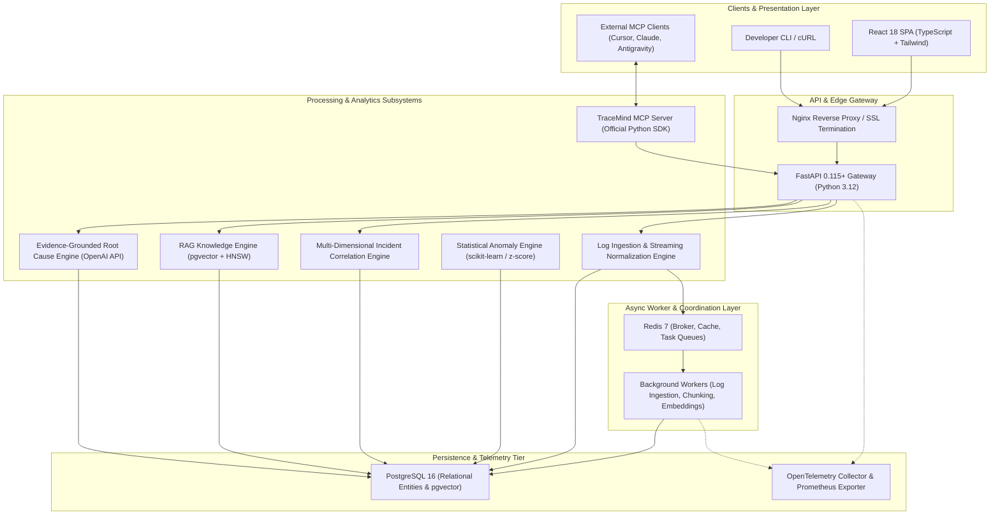
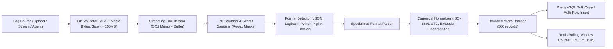
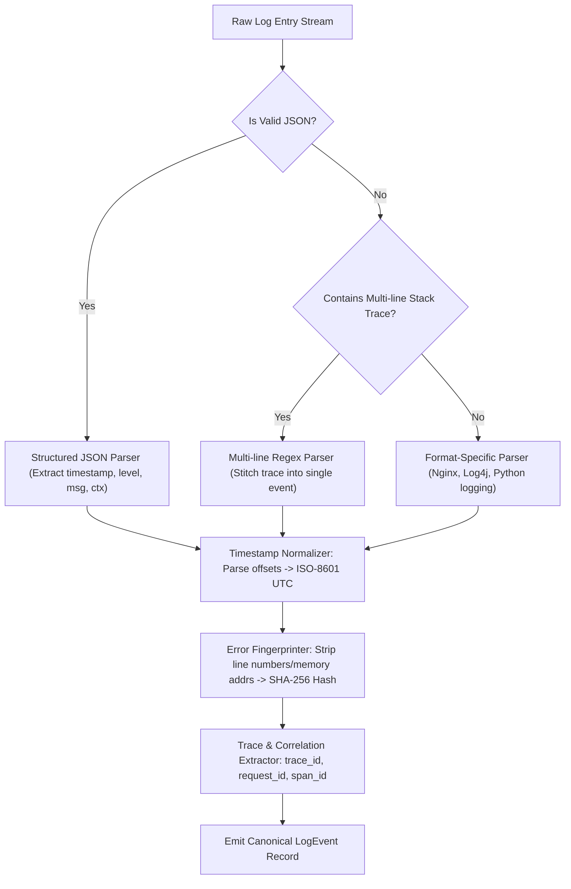
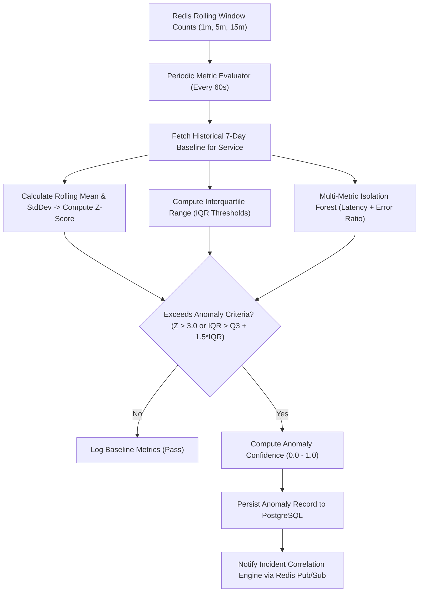
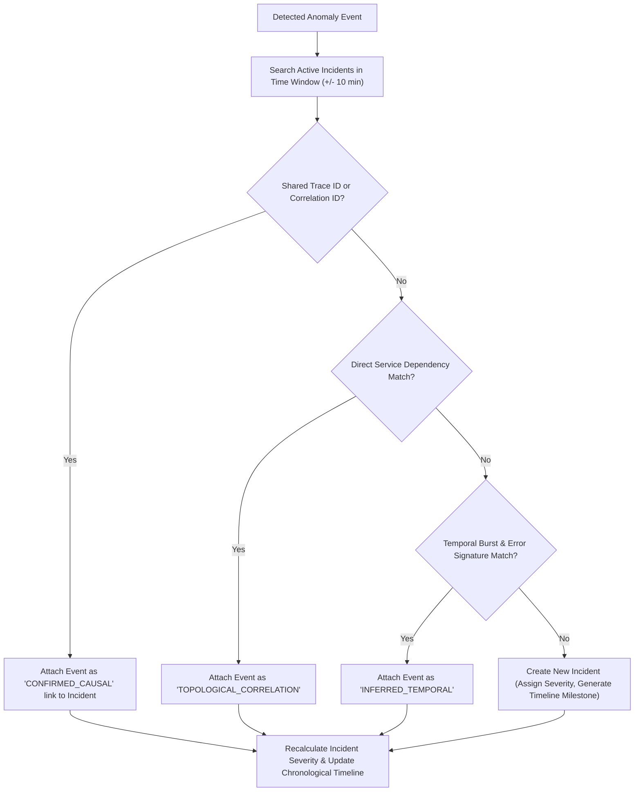
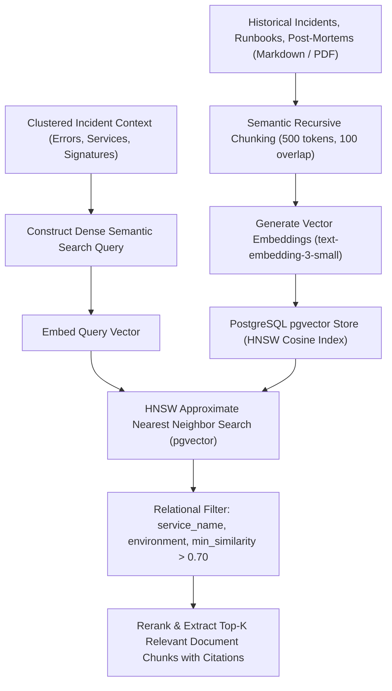
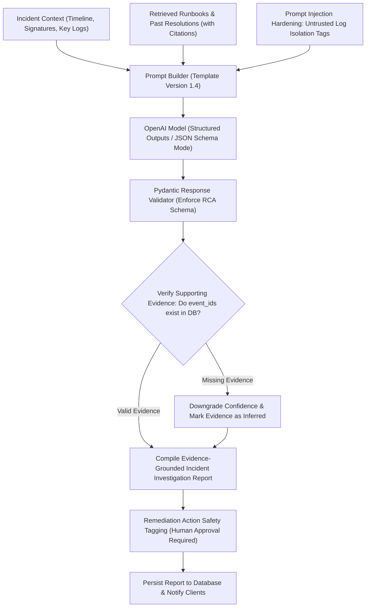
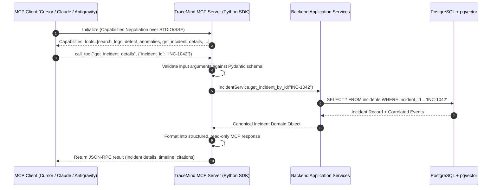
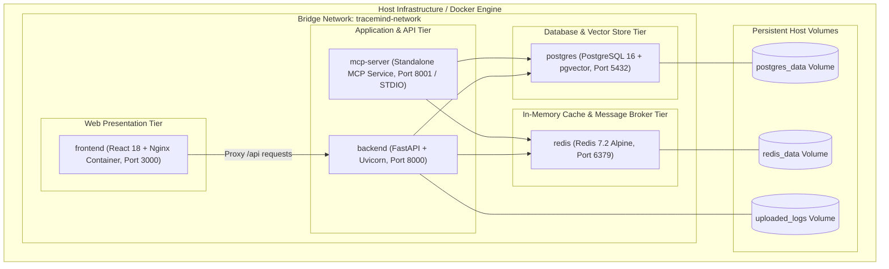
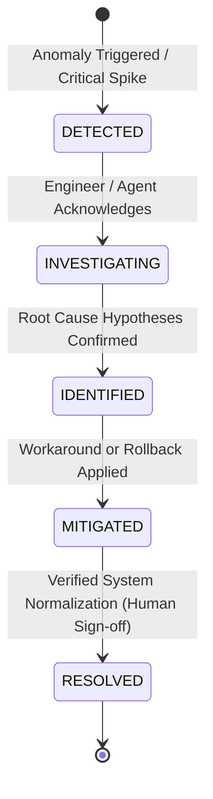

# TraceMind AI — System Architecture Specification

| **Document Metadata** | **Specification** |
| :--- | :--- |
| **Document Version** | 1.0.0-PROD |
| **System** | **TraceMind AI Incident Intelligence Platform** |
| **Author** | Anmol Vishvas ([anmol23vishvas@gmail.com](mailto:anmol23vishvas@gmail.com)) |
| **Target Repository** | [https://github.com/anmolvishvas/TraceMind-AI](https://github.com/anmolvishvas/TraceMind-AI) |
| **Status** | Production Architectural Blueprint |
| **Last Updated** | November 2026 |

---

## 1. High-Level Architecture & Topological Diagrams

TraceMind AI is structured around decoupled, event-driven, and micro-service aligned subsystems. The architecture strictly isolates deterministic statistical pipelines from non-deterministic LLM reasoning, ensuring high reliability, sub-second query performance, and verifiable audit trails.

### 1.1 Overall System Architecture



---

### 1.2 Log Ingestion Pipeline



---

### 1.3 Log Parsing and Normalization Flow



---

### 1.4 Anomaly Detection Pipeline



---

### 1.5 Incident Correlation Engine



---

### 1.6 RAG Retrieval and Generation Pipeline



---

### 1.7 LLM Root Cause Analysis Architecture



---

### 1.8 MCP Client-Server Communication Flow



---

### 1.9 Docker Deployment Topology



---

## 2. Core Subsystems

| Subsystem | Responsibilities & Functional Boundaries | Key Dependencies |
| :--- | :--- | :--- |
| **Frontend Presentation Layer** | Provides reactive, dark-mode first UI for incident exploration, log streams, timeline graphs, and AI investigation chat. | React 18, TypeScript, Tailwind CSS, Recharts, Vite |
| **FastAPI Application Layer** | Serves RESTful endpoints, orchestrates dependency injection, enforces request validation, and routes traffic. | FastAPI, Pydantic v2, Starlette |
| **Authentication & Authorization** | Validates JWT tokens, checks API keys, enforces tenant isolation and Role-Based Access Control (RBAC). | PyJWT, Passlib, Cryptography |
| **Log Ingestion Service** | Accepts log streams and multipart uploads, verifies file constraints, and orchestrates ingestion workers. | FastAPI UploadFile, aiofiles |
| **File Validation Service** | Inspects magic bytes, file extensions, MIME types, and enforces bounded size limits ($100\text{ MB}$). | python-magic, mimetypes |
| **Log Parser & Normalization Engine** | Converts heterogeneous raw log entries into canonical `LogEvent` records and computes deterministic stack trace hashes. | Regex, Python `datetime`, hashlib |
| **Log Storage Subsystem** | High-throughput insertion, index maintenance, and partitioned querying of structured log events. | SQLAlchemy 2.0 (asyncpg), PostgreSQL 16 |
| **Error Classification Engine** | Categorizes exceptions (Network, DB, Timeout, Auth, Memory) and tracks recurrence signatures. | Custom rules, Abstract Syntax Tree |
| **Anomaly Detection Engine** | Computes rolling statistical baselines, Z-scores, and IQR thresholds; isolates metric anomalies without LLM dependence. | `scikit-learn`, `numpy`, `scipy` |
| **Incident Correlation Engine** | Clusters disparate log events and anomalies into incidents via time burst windows, trace IDs, and service topology. | NetworkX, Network Graph Algorithms |
| **Incident Management Service** | Manages incident state machine (Detected, Investigating, Identified, Mitigated, Resolved) and event timelines. | SQLAlchemy 2.0, Pydantic v2 |
| **RAG Indexing Pipeline** | Extracts text from runbooks and historical post-mortems, generates semantic chunks, and creates vector embeddings. | RecursiveSplitter, OpenAI Embeddings |
| **Vector Retrieval Subsystem** | Executes HNSW approximate nearest-neighbor similarity searches in PostgreSQL using `pgvector`. | `pgvector-python`, SQLAlchemy 2.0 |
| **LLM Integration Layer** | Handles communication with OpenAI APIs, enforces token limits, manages prompt templates, and handles retries. | OpenAI Python SDK, Tenacity |
| **Root Cause Analysis Engine** | Synthesizes incident context, retrieved runbooks, and log evidence into structured hypotheses with mandatory citations. | Pydantic OutputParser, OpenAI |
| **MCP Server** | Implements the official Model Context Protocol Python SDK, exposing read-only incident tools over STDIO and SSE transports. | `mcp` SDK, AnyIO |
| **Background Processing Subsystem**| Executes long-running tasks (large log ingestion, bulk embeddings, statistical evaluations) asynchronously. | Redis, ARQ / Celery / asyncio workers |
| **Redis Caching & Coordination** | Stores rolling metrics counters, provides distributed locking, caches repeated queries, and brokers background tasks. | Redis 7, `redis-py` async |
| **PostgreSQL Persistence Layer** | Relational source of truth for entities, foreign keys, partition tables, and vector similarity indexes. | PostgreSQL 16 + `pgvector` extension |
| **Observability Subsystem** | Emits structured JSON logs, exposes Prometheus metrics at `/metrics`, and propagates OpenTelemetry trace contexts. | OpenTelemetry SDK, Prometheus Client |

---

## 3. Technology Stack Decisions & Rationale

### 3.1 Backend & Language: Python 3.12+
- **Selected Because:** Industry standard for AIOps, machine learning, and LLM orchestration; Python 3.12 provides improved execution speed (PEP 659 specializing adaptive interpreter), enhanced typing diagnostics, and native async support.
- **Alternatives Considered:** Go, Rust, Node.js (TypeScript).
- **Trade-offs:** Slightly lower raw single-threaded execution speed than Rust/Go, offset by the rich ecosystem of ML libraries (`scikit-learn`, `numpy`, `pgvector`, official `mcp` SDK).
- **Scalability Implications:** Completely mitigated by running asynchronous event loops (asyncpg, FastAPI, Uvicorn) and horizontal worker scaling.

### 3.2 Web Framework: FastAPI
- **Selected Because:** High-performance asynchronous API framework utilizing Pydantic v2 for automatic, high-speed validation and OpenAPI schema generation.
- **Alternatives Considered:** Flask, Django Ninja, Litestar.
- **Trade-offs:** Requires strict adherence to asynchronous non-blocking patterns to prevent event-loop stalls.
- **Scalability Implications:** Benchmarks consistently place FastAPI among the top Python frameworks for concurrency and I/O-bound operations.

### 3.3 Database & Vector Engine: PostgreSQL 16 + pgvector
- **Selected Because:** Unifies ACID relational persistence (incidents, logs, user accounts, audit history) and vector embeddings within a single, mature database engine, eliminating cross-database synchronization headaches.
- **Alternatives Considered:** Pinecone, Weaviate, Milvus, Qdrant + MongoDB.
- **Trade-offs:** Dedicated vector databases may handle billion-scale vectors faster, but `pgvector` HNSW index easily scales to tens of millions of vectors with sub-50ms latencies while preserving transactional relational constraints.
- **Scalability Implications:** Partitioning by timestamp allows scaling `log_events` to hundreds of millions of rows with continuous vacuuming.

### 3.4 In-Memory Cache & Broker: Redis 7
- **Selected Because:** Ultra-low-latency in-memory data store for sliding-window anomaly counters, distributed rate-limiting, and task queue coordination.
- **Alternatives Considered:** RabbitMQ, Apache Kafka, AWS SQS.
- **Trade-offs:** In-memory storage cost vs. persistence durability. Configured with AOF (Append Only File) persistence for critical queue states.
- **Scalability Implications:** Single Redis instance easily sustains $100,000+$ ops/sec; supports Redis Cluster if throughput expands.

### 3.5 AI & Embedding Provider: OpenAI API (text-embedding-3-small & GPT-4o / GPT-4o-mini)
- **Selected Because:** State-of-the-art reasoning quality for complex root cause inference and high-density, low-cost embeddings ($1536$-dimensions) with strong semantic search performance.
- **Alternatives Considered:** Self-hosted Llama 3 / Mistral, Anthropic Claude.
- **Trade-offs:** External SaaS dependency requiring network access and API credits; mitigated by strict timeout handling, circuit breakers, and decoupled architecture allowing local model fallback.
- **Scalability Implications:** Rate limits managed via exponential backoff and client-side token bucket limiters.

### 3.6 Machine Learning & Statistics: Scikit-learn & NumPy
- **Selected Because:** Rock-solid, deterministic numerical computation for Z-score baselines, IQR calculations, and Isolation Forests without introducing heavy deep learning framework overhead (e.g., PyTorch).
- **Alternatives Considered:** PyTorch, TensorFlow, Prophet.
- **Trade-offs:** Limited to classical statistical models, which are completely sufficient and significantly more interpretable for time-series error frequency anomalies.
- **Scalability Implications:** Extremely low CPU overhead per window evaluation; execution times $< 10\text{ ms}$ per service metric window.

### 3.7 External Integration: Official Model Context Protocol (MCP) Python SDK
- **Selected Because:** Official protocol standard backed by Anthropic and open ecosystem for connecting AI assistants directly to software development and operational tools.
- **Alternatives Considered:** Custom REST plugin endpoints, proprietary agent toolkits.
- **Trade-offs:** Protocol is evolving rapidly; mitigated by clean separation of the MCP transport layer from core application services.
- **Scalability Implications:** Supports lightweight STDIO for local IDE sessions and stateless SSE for network-based multi-tenant orchestrators.

---

## 4. Log Processing Architecture

### 4.1 Canonical Internal Log Event Schema

Every incoming log entry, regardless of source format, is parsed and normalized into the following strongly typed canonical schema:

```python
from datetime import datetime
from typing import Any, Dict, Optional
from pydantic import BaseModel, Field


class CanonicalLogEvent(BaseModel):
    """
    Production-grade canonical internal representation of an operational log entry.
    All ingestion pipelines must normalize source data into this exact structure.
    """

    event_id: str = Field(
        ..., description="Globally unique UUIDv7 identifier for the log event"
    )
    timestamp: datetime = Field(
        ..., description="Normalized UTC ISO-8601 timestamp of event emission"
    )
    severity: str = Field(
        ..., description="Normalized log level: DEBUG, INFO, WARN, ERROR, CRITICAL"
    )
    service_name: str = Field(
        ..., description="Identifier of the emitting microservice or application"
    )
    environment: str = Field(
        default="production",
        description="Runtime environment: production, staging, dev",
    )
    message: str = Field(
        ..., description="Cleaned, primary log message text (PII scrubbed)"
    )
    exception_type: Optional[str] = Field(
        None, description="Extracted class name of the exception if present"
    )
    stack_trace: Optional[str] = Field(
        None, description="Full normalized multi-line stack trace"
    )
    error_signature: Optional[str] = Field(
        None, description="SHA-256 hash of the normalized stack trace"
    )
    request_id: Optional[str] = Field(
        None, description="HTTP or RPC request correlation identifier"
    )
    trace_id: Optional[str] = Field(
        None, description="OpenTelemetry / W3C distributed trace identifier"
    )
    span_id: Optional[str] = Field(None, description="OpenTelemetry span identifier")
    correlation_id: Optional[str] = Field(
        None, description="Custom business transaction correlation ID"
    )
    source_file: Optional[str] = Field(
        None, description="Source file name or uploaded artifact name"
    )
    line_number: Optional[int] = Field(
        None, description="Source code line number if available"
    )
    metadata: Dict[str, Any] = Field(
        default_factory=dict, description="Arbitrary unindexed structured attributes"
    )
```

### 4.2 Ingestion & Normalization Specifications
1. **Streaming Processing:** Ingestion readers stream byte chunks using an internal buffer ($64\text{ KB}$), splitting lines on newline boundaries (`\r\n` or `\n`), ensuring constant memory usage even for $100\text{ MB}$ files.
2. **Timezone Normalization:** Timestamps in diverse formats (`2026-11-18 09:30:00,123`, `18/Nov/2026:09:30:00 +0530`, `1731922200000`) are parsed using strict datetime formatters, converted to UTC, and stored as timezone-aware database timestamps.
3. **Multi-line Exception Stitching:** The parser detects continuation lines (starting with whitespace, `at `, `Traceback (most recent call last):`, or `Caused by:`) and joins them with the preceding root log line into a unified `stack_trace` string.
4. **Deterministic Error Signature Generation:**
   - Stack traces contain dynamic runtime artifacts (memory addresses like `0x7f9a12c8`, line numbers, thread IDs).
   - The normalizer applies regex transformations to replace `0x[0-9a-fA-F]+` with `0xHEX` and `:line [0-9]+` with `:line N`.
   - The cleaned trace is hashed using SHA-256 to generate `error_signature`, enabling instant grouping of identical bugs across services.

---

## 5. Anomaly Detection Architecture

### 5.1 Decoupling Principle
Numerical anomaly detection operates strictly through deterministic mathematical algorithms. Under no circumstances is an LLM prompted to evaluate whether an error rate or metric frequency is anomalous.

### 5.2 Mathematical Formulation & Algorithms

#### 1. Sliding Window Aggregation
For each active service $s$, log events are bucketed into discrete time windows $W_t$ of duration $\Delta t \in \{1\text{m}, 5\text{m}, 15\text{m}\}$. The error frequency $x_t$ represents the count of `ERROR` and `CRITICAL` events within $W_t$.

#### 2. Modified Z-Score with Exponential Moving Average (EMA)
Historical mean $\mu_t$ and standard deviation $\sigma_t$ are maintained using rolling exponential decay over a 7-day lookback window:
$$\mu_t = \alpha x_t + (1 - \alpha) \mu_{t-1}$$
$$\sigma_t = \sqrt{\alpha (x_t - \mu_t)^2 + (1 - \alpha) \sigma_{t-1}^2}$$
The standard Z-score is evaluated:
$$Z_t = \frac{x_t - \mu_t}{\sigma_t + \epsilon}$$
Where $\epsilon = 10^{-6}$ prevents division by zero during periods of total calm.
An anomaly is triggered if $Z_t \ge 3.0$ (representing a $99.73\%$ confidence departure from baseline).

#### 3. Interquartile Range (IQR) for Non-Normal Burst Distributions
For bursty microservice architectures where error distributions are heavy-tailed:
$$\text{IQR} = Q_3 - Q_1$$
$$\text{Threshold}_{\text{Upper}} = Q_3 + 1.5 \times \text{IQR}$$
An anomaly is flagged if $x_t > \text{Threshold}_{\text{Upper}}$ and $x_t \ge 10$ (minimum absolute threshold to eliminate single-event noise).

#### 4. Anomaly Confidence Scoring
The composite confidence score $C_{\text{ano}} \in [0.0, 1.0]$ is computed as:
$$C_{\text{ano}} = \min\left(1.0, \frac{Z_t - 3.0}{5.0} \times 0.5 + \frac{x_t - \text{Threshold}_{\text{Upper}}}{\text{Threshold}_{\text{Upper}}} \times 0.5\right)$$

---

## 6. Incident Correlation Architecture

### 6.1 Multi-Dimensional Correlation Matrix
When an anomaly or critical error occurs, the Correlation Engine evaluates candidate linkages against existing active incidents using a weighted graph:

| Dimension | Correlation Mechanism | Weight | Link Type |
| :--- | :--- | :--- | :--- |
| **Trace ID / Span ID** | Exact string match across distributed trace headers. | $1.00$ | `CONFIRMED_CAUSAL` |
| **Request / Correlation ID**| Exact match on HTTP header / context correlation ID. | $0.95$ | `CONFIRMED_CAUSAL` |
| **Topology Dependency** | Direct edge in service dependency graph within $\pm 3\text{ minutes}$. | $0.80$ | `TOPOLOGICAL_CORRELATION`|
| **Signature Co-occurrence** | Identical `error_signature` appearing across nodes. | $0.75$ | `SIGNATURE_CLUSTER` |
| **Temporal Burst Adjacency**| Shared burst spike within sliding $\pm 5\text{ minute}$ window. | $0.60$ | `INFERRED_TEMPORAL` |

### 6.2 Incident State Machine



---

## 7. Retrieval-Augmented Generation (RAG) Architecture

### 7.1 Knowledge Base Schema & Indexing
Historical incident post-mortems and markdown runbooks are ingested into PostgreSQL using the following schema:

```sql
CREATE EXTENSION IF NOT EXISTS vector;

CREATE TABLE rag_knowledge_documents (
    document_id UUID PRIMARY KEY DEFAULT gen_random_uuid(),
    title VARCHAR(255) NOT NULL,
    source_type VARCHAR(50) NOT NULL, -- 'RUNBOOK', 'POST_MORTEM', 'ARCHITECTURE_DOC'
    service_name VARCHAR(100),
    environment VARCHAR(50) DEFAULT 'production',
    raw_content TEXT NOT NULL,
    metadata JSONB DEFAULT '{}'::jsonb,
    created_at TIMESTAMPTZ DEFAULT NOW(),
    updated_at TIMESTAMPTZ DEFAULT NOW()
);

CREATE TABLE rag_knowledge_chunks (
    chunk_id UUID PRIMARY KEY DEFAULT gen_random_uuid(),
    document_id UUID NOT NULL REFERENCES rag_knowledge_documents(document_id) ON DELETE CASCADE,
    chunk_index INT NOT NULL,
    chunk_text TEXT NOT NULL,
    token_count INT NOT NULL,
    embedding vector(1536) NOT NULL, -- text-embedding-3-small dimension
    section_header VARCHAR(255),
    created_at TIMESTAMPTZ DEFAULT NOW()
);

CREATE INDEX idx_rag_chunks_hnsw ON rag_knowledge_chunks 
USING hnsw (embedding vector_cosine_ops) 
WITH (m = 16, ef_construction = 64);
```

### 7.2 Retrieval Query Execution
The RAG subsystem executes hybrid similarity searches combining relational filters with vector cosine distance:

```sql
SELECT 
    c.chunk_id,
    c.chunk_text,
    c.section_header,
    d.title AS document_title,
    d.source_type,
    1 - (c.embedding <=> :query_vector) AS cosine_similarity
FROM rag_knowledge_chunks c
JOIN rag_knowledge_documents d ON c.document_id = d.document_id
WHERE (d.service_name = :service_name OR d.service_name IS NULL)
  AND (1 - (c.embedding <=> :query_vector)) >= 0.70
ORDER BY c.embedding <=> :query_vector ASC
LIMIT 5;
```

---

## 8. LLM Root Cause Analysis (RCA) Architecture

### 8.1 Evidence-Verification Loop
To eliminate hallucinations, the RCA engine wraps the LLM generation within a verification loop:
1. **Context Construction:** Only canonicalized logs belonging to the correlated incident and verified top-K RAG chunks are injected.
2. **Prompt Boundary Security:** Raw log text is sanitized and encapsulated inside `<untrusted_system_logs>` tags.
3. **Structured Response Contract:** The LLM must output valid JSON conforming to the `RootCauseAnalysisReport` schema.
4. **Evidence Validation Step:** Before presenting the report to the user, the backend queries the database to ensure every `event_id` referenced in `supporting_evidence` actually exists in the incident's log partition. Any fabricated `event_id` causes an immediate penalty to the confidence score and triggers an explicit warning label.

```python
from typing import List
from pydantic import BaseModel, Field


class SupportingEvidenceItem(BaseModel):
    event_id: str = Field(
        ..., description="Exact UUIDv7 event_id of the supporting log entry"
    )
    timestamp: str = Field(..., description="Timestamp of the referenced event")
    log_snippet: str = Field(..., description="Verbatim text from the referenced log")
    relevance_explanation: str = Field(
        ..., description="Why this log entry supports the hypothesis"
    )


class RootCauseAnalysisReport(BaseModel):
    summary: str = Field(..., description="Executive summary of the incident")
    primary_hypothesis: str = Field(..., description="The most probable root cause")
    confidence_score: float = Field(
        ..., ge=0.0, le=1.0, description="Mathematical confidence"
    )
    supporting_evidence: List[SupportingEvidenceItem] = Field(
        ..., description="Direct log citations"
    )
    alternative_hypotheses: List[str] = Field(default_factory=list)
    investigation_steps: List[str] = Field(
        ..., description="Actionable diagnostic steps"
    )
    recommended_remediations: List[str] = Field(
        ..., description="Proposed fixes (requires human approval)"
    )
    citations: List[str] = Field(
        default_factory=list, description="Runbook document references"
    )
```

---

## 9. Model Context Protocol (MCP) Server Architecture

### 9.1 Server Implementation Standard
TraceMind AI implements the official Model Context Protocol Python SDK (`mcp`). The MCP server exposes incident intelligence capabilities to external AI clients (e.g., Cursor, Claude Desktop, Antigravity IDE) while delegating 100% of internal query operations to core FastAPI backend services.

### 9.2 Tool Registry

```python
# Conceptual MCP Tool Registry Signature
from mcp.server.fastmcp import FastMCP

mcp = FastMCP("TraceMind-AI-Incident-Server")


@mcp.tool()
async def search_logs(
    service_name: str, query: str, severity: str = "ERROR", limit: int = 50
) -> str:
    """Search canonicalized application logs with filtering."""
    ...


@mcp.tool()
async def get_incident_details(incident_id: str) -> str:
    """Retrieve full incident metadata, severity, impacted services, and state."""
    ...


@mcp.tool()
async def get_incident_timeline(incident_id: str) -> str:
    """Retrieve the chronological event progression timeline of an incident."""
    ...


@mcp.tool()
async def search_historical_incidents(query: str, limit: int = 3) -> str:
    """Semantic vector search across past incident reports and runbooks."""
    ...
```

---

## 10. Complete Project Directory Structure

```
TraceMind-AI/
├── .github/
│   ├── PULL_REQUEST_TEMPLATE.md
│   └── workflows/
│       ├── ci.yml               # Main CI Pipeline (Lint, Typecheck, Test, Audit, Docker)
│       └── pr-audit.yml         # PR Governance (Conventional Commits, Auto-labeling)
├── assets/
│   ├── logo.png                 # Official High-Resolution TraceMind AI Logo
│   └── logo-card.jpg            # Brand Card Asset
├── docs/
│   ├── PRD.md                   # Product Requirements Document
│   ├── ARCHITECTURE.md          # System Architecture Specification (This Document)
│   ├── RULES.md                 # AI & Developer Engineering Rulebook
│   ├── DESIGN.md                # UI/UX Specification & Design System
│   ├── TASKS.md                 # Phased Implementation Plan & Task Tracker
│   └── MEMORY.md                # Living Project Journal & Architectural Decision Records
├── backend/
│   ├── Dockerfile               # Multi-stage, non-root Python 3.12 Dockerfile
│   ├── README.md                # Backend Setup & Architecture Documentation
│   ├── alembic.ini              # Database migration configuration
│   ├── pyproject.toml           # Backend dependencies, Ruff, mypy, pytest configs
│   ├── app/
│   │   ├── __init__.py
│   │   ├── main.py              # FastAPI application factory & root routing
│   │   ├── api/
│   │   │   ├── __init__.py
│   │   │   ├── deps.py          # Database session and auth dependency injection
│   │   │   └── v1/
│   │   │       ├── __init__.py
│   │   │       ├── router.py    # Master v1 API router
│   │   │       ├── endpoints/
│   │   │       │   ├── health.py
│   │   │       │   ├── logs.py
│   │   │       │   ├── anomalies.py
│   │   │       │   ├── incidents.py
│   │   │       │   ├── rag.py
│   │   │       │   └── rca.py
│   │   ├── core/
│   │   │   ├── __init__.py
│   │   │   ├── config.py        # Pydantic v2 BaseSettings environment configuration
│   │   │   ├── database.py      # SQLAlchemy 2.0 async engine & sessionmaker
│   │   │   ├── exceptions.py    # Custom domain exception hierarchy
│   │   │   ├── logging.py       # Structured JSON logging configuration
│   │   │   └── security.py      # JWT authentication and PII masking utilities
│   │   ├── log_processing/
│   │   │   ├── __init__.py
│   │   │   ├── validator.py     # File MIME and byte validation
│   │   │   ├── normalizer.py    # Timestamp and canonical normalization
│   │   │   ├── fingerprinter.py # Stack trace hashing and signature generation
│   │   │   └── parsers/
│   │   │       ├── __init__.py
│   │   │       ├── base.py
│   │   │       ├── json_parser.py
│   │   │       ├── python_parser.py
│   │   │       ├── java_parser.py
│   │   │       ├── nginx_parser.py
│   │   │       └── docker_parser.py
│   │   ├── anomaly_detection/
│   │   │   ├── __init__.py
│   │   │   ├── baseline.py      # Rolling EMA and statistics calculator
│   │   │   ├── statistical.py   # Z-score, IQR, and Isolation Forest implementations
│   │   │   └── evaluator.py     # Anomaly scoring and trigger orchestrator
│   │   ├── incidents/
│   │   │   ├── __init__.py
│   │   │   ├── correlator.py    # Multi-dimensional event correlation engine
│   │   │   ├── timeline.py      # Chronological timeline builder
│   │   │   └── state_machine.py # Incident lifecycle management
│   │   ├── rag/
│   │   │   ├── __init__.py
│   │   │   ├── chunker.py       # Recursive text chunking with metadata
│   │   │   ├── embedder.py      # OpenAI embedding client
│   │   │   └── vector_store.py  # pgvector similarity search repository
│   │   ├── llm/
│   │   │   ├── __init__.py
│   │   │   ├── client.py        # OpenAI API client wrapper with retries
│   │   │   ├── prompts.py       # Versioned prompt templates
│   │   │   └── rca_engine.py    # Evidence verification & hypothesis generator
│   │   ├── mcp/
│   │   │   ├── __init__.py
│   │   │   ├── server.py        # Official MCP Python SDK server implementation
│   │   │   ├── tools.py         # Strongly typed MCP tool definitions
│   │   │   └── schemas.py       # Pydantic input/output contracts
│   │   ├── models/
│   │   │   ├── __init__.py
│   │   │   ├── log_event.py     # SQLAlchemy model for log_events
│   │   │   ├── anomaly.py       # SQLAlchemy model for anomalies
│   │   │   ├── incident.py      # SQLAlchemy model for incidents and correlations
│   │   │   └── rag.py           # SQLAlchemy model for documents and vectors
│   │   ├── schemas/
│   │   │   ├── __init__.py
│   │   │   ├── log_event.py     # Pydantic CanonicalLogEvent schema
│   │   │   ├── anomaly.py       # Pydantic AnomalyEvent schema
│   │   │   ├── incident.py      # Pydantic Incident and Timeline schemas
│   │   │   └── rca.py           # Pydantic RootCauseAnalysisReport schema
│   │   └── services/
│   │       ├── __init__.py
│   │       ├── log_service.py
│   │       ├── incident_service.py
│   │       └── rca_service.py
│   └── tests/
│       ├── __init__.py
│       ├── conftest.py          # Shared fixtures (async db, test client, mock LLM)
│       ├── unit/
│       │   ├── test_parsers.py
│       │   ├── test_anomaly.py
│       │   ├── test_correlation.py
│       │   └── test_schemas.py
│       └── integration/
│           ├── test_health.py
│           ├── test_log_pipeline.py
│           └── test_mcp_tools.py
├── frontend/
│   ├── Dockerfile               # Multi-stage Node 20 build -> Nginx Alpine
│   ├── README.md                # Frontend documentation
│   ├── package.json             # React 18, TypeScript, Tailwind, Recharts
│   ├── tsconfig.json            # Strict TypeScript configuration
│   ├── tailwind.config.js       # Enterprise dark-mode design tokens
│   ├── vite.config.ts           # Vite build and proxy settings
│   ├── public/
│   └── src/
│       ├── App.tsx
│       ├── main.tsx
│       ├── components/
│       ├── pages/
│       └── services/
├── docker-compose.yml           # Local multi-service orchestration (Postgres, Redis, App)
├── .gitignore                   # Production git exclusion rules
└── README.md                    # Repository landing page with architecture & logo
```
