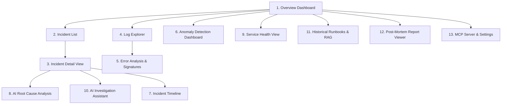

# TraceMind AI — UI/UX Specification & Design System

| **Design Document Metadata** | **Specification** |
| :--- | :--- |
| **Document Version** | 1.0.0-PROD |
| **System** | **TraceMind AI Incident Intelligence Platform** |
| **Target Audience** | Site Reliability Engineers, DevOps Engineers, Backend Developers, Engineering Leads |
| **Author** | Anmol Vishvas ([anmol23vishvas@gmail.com](mailto:anmol23vishvas@gmail.com)) |
| **Theme** | Dark-Mode First Enterprise Telemetry & AIOps |
| **Last Updated** | November 2026 |

---

## 1. Design Principles

1. **Information Density Without Cognitive Clutter:** 
   Incident responders are under intense pressure during outages. The interface must maximize screen real estate for telemetry, stack traces, and evidence graphs while eliminating decorative fluff.
2. **Instant Status & Severity Recognition:** 
   Critical system health and incident severities must be immediately distinguishable within $100\text{ ms}$ of visual scanning using high-contrast semantic color tokens.
3. **Evidence-First AI Insights:** 
   AI hypotheses and summaries are never displayed as ungrounded narrative text. Every AI-generated claim is styled alongside clickable citations, raw log event IDs, and confidence badges.
4. **Developer-Friendly Investigation Workflows:** 
   Prioritize keyboard navigation, monotonic log viewing, one-click copy for stack traces and correlation IDs, and split-screen comparison layouts.
5. **Real-Time Operational Visibility:** 
   Smooth live polling and SSE updates for log feeds, anomaly spikes, and incident timeline milestones with clear visual pulses.

---

## 2. Visual Identity & Design Tokens

### 2.1 Brand Personality
- **Tone:** Technical, authoritative, analytical, reliable, high-precision.
- **Visual Motif:** Deep terminal dark mode infused with glowing cyan telemetry accents, neon incident status indicators, and clean monospace code hierarchies.

### 2.2 Color Palette (Dark-Mode Primary)

| Color Token | Hex Code | Purpose / UI Application |
| :--- | :--- | :--- |
| **Background / Canvas** | `#090D16` | Main application background (Deep Slate Obsidian) |
| **Surface / Card Background** | `#111827` | Cards, panels, modals, sidebar background |
| **Surface Elevated** | `#1F2937` | Hover states, dropdown menus, table headers |
| **Border / Divider** | `#374151` | Subtle container borders and separators |
| **Primary Brand (Cyan)** | `#06B6D4` | Primary actions, active navigation, AI highlight accents |
| **Secondary Accent (Violet)**| `#8B5CF6` | RAG knowledge base badges, AI assistant indicators |
| **Text Primary** | `#F9FAFB` | Headings, primary metrics, active text |
| **Text Secondary** | `#9CA3AF` | Supporting text, timestamps, labels, descriptions |
| **Text Muted** | `#6B7280` | Placeholders, inactive icons, disabled states |

### 2.3 Semantic Severity Tokens

| Severity Level | Background Pill | Text / Accent Color | Border Color | Description |
| :--- | :--- | :--- | :--- | :--- |
| **CRITICAL** | `#450A0A` (10% Red) | `#EF4444` (Vibrant Red) | `#B91C1C` | Outage, core service failure, error burst $> 500\%$ |
| **HIGH** | `#431407` (10% Orange)| `#F97316` (Neon Orange)| `#C2410C` | Major degradation, unhandled exceptions in primary service |
| **MEDIUM** | `#451A03` (10% Amber) | `#F59E0B` (Amber Yellow)| `#B45309` | Non-fatal exceptions, elevated warnings, single node |
| **LOW** | `#082F49` (10% Sky) | `#38BDF8` (Sky Blue) | `#0284C7` | Minor warnings, transient latency deviations |
| **INFO / RESOLVED** | `#052E16` (10% Green)| `#10B981` (Emerald Green)| `#047857` | Healthy state, normalized baseline, verified resolution |

### 2.4 Typography Scale
- **Primary Font Family:** `Inter`, `-apple-system`, `BlinkMacSystemFont`, `sans-serif`
- **Monospace Font Family:** `JetBrains Mono`, `Fira Code`, `Consolas`, `monospace` (Used for all logs, stack traces, correlation IDs, timestamps, and queries).

| Style | Font Family | Size | Weight | Line Height | Tracking |
| :--- | :--- | :--- | :--- | :--- | :--- |
| **Display Heading** | Inter | $28\text{ px}$ | Bold (700) | $36\text{ px}$ | $-0.02\text{ em}$ |
| **Section Heading** | Inter | $20\text{ px}$ | SemiBold (600)| $28\text{ px}$ | $-0.01\text{ em}$ |
| **Card Heading** | Inter | $16\text{ px}$ | Medium (500) | $24\text{ px}$ | $0.00\text{ em}$ |
| **Body Primary** | Inter | $14\text{ px}$ | Regular (400) | $20\text{ px}$ | $0.00\text{ em}$ |
| **Caption / Meta** | Inter | $12\text{ px}$ | Regular (400) | $16\text{ px}$ | $+0.01\text{ em}$ |
| **Code / Log Line** | JetBrains Mono | $13\text{ px}$ | Regular (400) | $20\text{ px}$ | $0.00\text{ em}$ |

### 2.5 Spacing, Radii, & Elevation
- **Spacing Scale:** Multiples of $4\text{ px}$ (`4px`, `8px`, `12px`, `16px`, `24px`, `32px`).
- **Border Radius:**
  - Cards & Panels: `8px` (`rounded-lg`)
  - Badges & Buttons: `6px` (`rounded-md`)
  - Modals & Floating Drawers: `12px` (`rounded-xl`)
- **Elevation Shadows:**
  - Card Shadow: `0 4px 6px -1px rgba(0, 0, 0, 0.4), 0 2px 4px -2px rgba(0, 0, 0, 0.3)`
  - Elevated Dropdown: `0 10px 15px -3px rgba(0, 0, 0, 0.6)`

---

## 3. Main Application Screens

### 3.1 Overview Dashboard
- **Layout:** 4-column KPI cards across the top, split main view (70% active incidents and anomaly trend chart, 30% service health status and recent system events).
- **Key Components:**
  - Metric Cards: Total Incidents (24h), Active Outages, MTTI Average, Error Spike Ratio.
  - Interactive Recharts Line Graph: Time-series error volume with overlaid statistical anomaly markers ($Z > 3\sigma$).
  - Active Incidents Table: Prioritized by severity (`CRITICAL` first) with pulsing live status dots.

### 3.2 Incident List & Triage View
- **Layout:** Filter bar on top (Service, Severity, Status, Timeframe), tabular list of incidents with quick-action drawers.
- **Columns:** Incident ID (`#INC-1042`), Severity Badge, Status Badge, Title / Error Signature, Impacted Services, Earliest Event Time, Event Count, Assigned Lead.
- **Interactions:** Keyboard arrows to navigate, `Enter` to open details, click to expand inline event summary.

### 3.3 Incident Detail Workspace (Command Center)
- **Layout:** Three-column split workspace:
  - *Left Panel (25%):* Incident Metadata, Impacted Services, Severity Controller, State Machine Transition Buttons (Investigating $\rightarrow$ Identified $\rightarrow$ Mitigated $\rightarrow$ Resolved [Human Confirmation Modal]).
  - *Center Panel (50%):* Dynamic Tab Switcher:
    - Tab 1: Chronological Incident Timeline with cascading service milestone events.
    - Tab 2: Correlated Log Stream (filtered to the incident burst window).
    - Tab 3: Statistical Anomaly Breakdown (Z-score and baseline charts).
  - *Right Panel (25%):* AI Investigation Assistant & Evidence-Grounded RCA Card.

### 3.4 Log Explorer
- **Layout:** Full-width high-density monospace log table with advanced query input.
- **Features:** 
  - Regex and keyword filtering bar.
  - Multi-select facet filters: `service_name`, `severity`, `environment`, `error_signature`.
  - Expandable row revealing structured JSON metadata and formatted stack traces.
  - One-click "Find Correlated Logs" and "Create Incident from Log Selection".

### 3.5 Error Signature Analysis
- **Layout:** Grouped list of unique error signatures hashed from normalized stack traces.
- **Details:** Displays occurrence count, first seen timestamp, last seen timestamp, impacted microservices, and sample cleaned stack trace.

### 3.6 Anomaly Detection Dashboard
- **Layout:** Multi-service metric grid showing rolling 1m, 5m, 15m error rates against 7-day baselines.
- **Visuals:** Shaded normal distribution bands ($\pm 3\sigma$) with red spike markers showing exact anomaly trigger points and confidence scores.

### 3.7 AI Root Cause Analysis (RCA) Panel
- **Components:**
  - Executive Summary callout box with cyan highlight border.
  - Primary Hypothesis Card with numerical confidence dial ($0.0 - 1.0$).
  - Supporting Evidence List: Clickable badges displaying `event_id` and timestamp. Clicking immediately highlights the corresponding log line in the center log viewer.
  - Safe Diagnostic Steps: Syntax-highlighted bash/SQL commands with "Copy Command" button and safety classification tag (`SAFE_READ_ONLY`).
  - Actionable Mitigation Recommendations with explicit human approval checkbox.

### 3.8 Historical Knowledge Base (RAG)
- **Features:**
  - Runbook and past post-mortem search input with semantic similarity matching.
  - Document upload interface (Markdown and PDF).
  - List of indexed documents with chunk count, embedding status, and vector dimensions.
  - Similarity score indicator on search results with verbatim text excerpt and section header.

### 3.9 Interactive Incident Investigation Chat
- **Layout:** Embedded drawer or expandable modal with multi-turn conversation history.
- **Capabilities:**
  - Streaming markdown responses.
  - Pre-built suggested investigation prompts (*"What triggered the first 500 error?"*, *"Show me similar historical incidents"*, *"Summarize cascading failures across services"*).
  - Verified source citation pills attached to assistant bubbles.

### 3.10 MCP Server Configuration & Diagnostics
- **Layout:** Technical diagnostics view detailing active MCP transports (STDIO and SSE).
- **Features:**
  - List of registered tools with full JSON schemas and descriptions.
  - Live execution log of MCP queries invoked by external clients (Cursor, Claude, Antigravity).
  - Token consumption and latency metrics per tool invocation.

---

## 4. Reusable Component Anatomy

### 4.1 Incident Severity Badge (`<SeverityBadge />`)
- **Anatomy:** Outer container pill with 10% opacity background, solid 1px border, 6px pulsing dot (for `CRITICAL` and `HIGH`), and bold uppercase label (`CRITICAL`, `HIGH`, `MEDIUM`, `LOW`, `INFO`).
- **States:** Default, Hover (subtle glow), Focus (keyboard outline).

### 4.2 Log Viewer Row (`<LogViewerRow />`)
- **Anatomy:**
  1. Timestamp column (Monospace, gray `#9CA3AF`, width 180px).
  2. Level column (Colored tag: Red for `ERROR`, Yellow for `WARN`, Blue for `INFO`).
  3. Service column (Badge, cyan text, width 120px).
  4. Message preview (Truncated with ellipsis, monospace font).
  5. Expand toggle icon.
- **Expanded Drawer:** Displays full un-truncated message, normalized stack trace with syntax highlighting, and structured JSON key-value tags.

### 4.3 Evidence Citation Card (`<EvidenceCard />`)
- **Anatomy:** Compact rounded container (`#1F2937`) featuring:
  - Header: `event_id` link (e.g., `#evt-89231`), timestamp, and emitting service.
  - Body: 2-line verbatim log excerpt.
  - Footer: "Verified in Database" green checkmark badge.
- **Interaction:** Clicking focuses and scrolls the Log Explorer to that exact event.

### 4.4 Diagnostic Command Box (`<DiagnosticBox />`)
- **Anatomy:** Monospace code block with dark slate background (`#090D16`), left border colored by safety level (Green for `SAFE_READ_ONLY`, Red for `HIGH_RISK`).
- **Elements:** Safety badge, command text, one-click copy button with animated tooltip confirmation (*"Copied!"*).

### 4.5 System States
- **Loading State:** Skeleton shimmers on cards and tables with subtle pulsing animation matching theme colors (`#1F2937` to `#374151`).
- **Empty State:** Clean technical illustration, descriptive message (*"No active incidents detected in selected timeframe"*), and action button (*"View Log Stream"*).
- **Error State:** High-contrast alert banner with retry trigger and technical error code reference.
