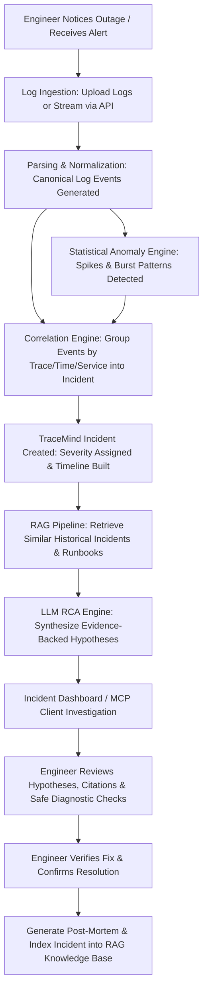
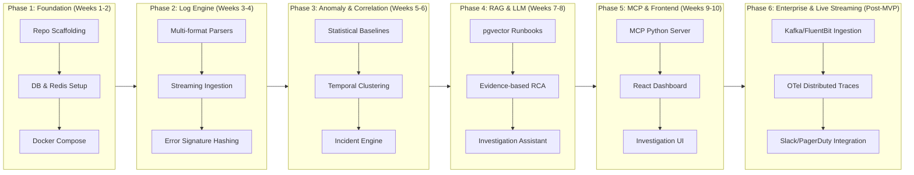

# TraceMind AI — Product Requirements Document (PRD)

| **Document Metadata** | **Specification** |
| :--- | :--- |
| **Product Name** | **TraceMind AI** |
| **Document Version** | 1.0.0-PROD |
| **Author** | Anmol Vishvas ([anmol23vishvas@gmail.com](mailto:anmol23vishvas@gmail.com)) |
| **Repository** | [https://github.com/anmolvishvas/TraceMind-AI](https://github.com/anmolvishvas/TraceMind-AI) |
| **Target Branch** | `main` |
| **Status** | Approved for Foundation & Phase 1 Execution |
| **Last Updated** | November 2026 |

---

## 1. Product Overview

### 1.1 Product Vision
**TraceMind AI** is an enterprise-grade, AI-powered incident intelligence and root cause analysis (RCA) platform designed to eliminate cognitive overload for software engineers, Site Reliability Engineers (SREs), and DevOps teams during critical production outages. By unifying streaming and batch log ingestion, rigorous statistical anomaly detection, deterministic multi-dimensional event correlation, Model Context Protocol (MCP) interoperability, and Retrieval-Augmented Generation (RAG) backed by historical post-mortems and runbooks, TraceMind AI acts as an autonomous tier-1 and tier-2 incident investigation partner.

### 1.2 Product Positioning
Unlike conventional log aggregators (e.g., Datadog, Splunk, Elastic) that provide raw search dashboards requiring extensive manual query crafting, or generic LLM chatbots that hallucinate plausible-sounding explanations without verifiable grounding, TraceMind AI provides **evidence-backed, deterministic incident intelligence**. Every finding, correlation, and remediation hypothesis generated by TraceMind AI is strictly anchored to canonicalized log events, verifiable timestamps, deterministic stack trace signatures, and versioned operational runbooks.

### 1.3 Core Problem Statement
Modern microservice architectures, cloud-native deployments, and distributed systems generate terabytes of semi-structured and unstructured operational logs daily. When production incidents occur:
1. **High Mean Time to Identify (MTTI) and Mean Time to Mitigate (MTTM):** Engineers are bombarded with thousands of concurrent log messages, cascading errors, and noisy alert storms across decoupled microservices. Identifying the origin of failure requires searching across multiple index patterns.
2. **Tribal Knowledge & Ignored Historical Precedents:** Critical institutional knowledge regarding prior outages, runbooks, and resolutions is trapped in disparate tools (Confluence, Jira post-mortems, Slack threads, past tickets). On-call engineers frequently re-investigate problems that have already been resolved and documented previously.
3. **LLM Hallucinations in AIOps:** Naive attempts to feed raw logs into commercial LLMs fail due to token limits, prompt injection vulnerabilities within user-controlled log payloads, context contamination, and high hallucination rates where the model guesses imaginary database queries or network faults.

### 1.4 Proposed Solution
TraceMind AI establishes a three-tier processing pipeline:
1. **Deterministic Ingestion & Statistical Analysis Engine:** High-throughput streaming log normalization, error signature hashing, and time-series statistical anomaly detection (Z-score, IQR, Isolation Forest) completely decoupled from LLMs.
2. **Multi-Dimensional Incident Correlation Subsystem:** Clusters disparate log lines into cohesive incidents using sliding temporal burst windows, distributed trace IDs, service dependency topologies, and stack trace finger-printing.
3. **Evidence-Grounded RAG & LLM Root Cause Reasoning:** Leverages PostgreSQL + `pgvector` to index runbooks and historical incident post-mortems. When an incident is clustered, TraceMind AI retrieves semantically relevant historical resolutions, passes bounded, sanitized log evidence into OpenAI reasoning models, and produces structured, verifiable investigation reports accompanied by human-approval-gated remediation actions.
4. **Model Context Protocol (MCP) Integration:** Exposes strongly typed, read-only operational tools over STDIO/SSE to external AI developer agents (such as Antigravity, Claude Code, Cursor, and internal LLM orchestrators).

### 1.5 Key Differentiators
- **Strict Decoupling of Statistics and LLMs:** Numerical anomaly detection is performed via deterministic Python statistical algorithms (`scikit-learn`, `numpy`), preventing LLM hallucinations from fabricating metric spikes.
- **Evidence-First Verification Loop:** Every root cause hypothesis must cite specific `event_id` records, timestamps, and stack traces. Hypotheses with insufficient evidence are explicitly categorized as unconfirmed speculations.
- **Zero-Resolution Auto-Claim Rule:** The system is architecturally prohibited from automatically marking an incident as resolved or executing remediation scripts without explicit human sign-off.
- **Native MCP Ecosystem Citizen:** Implements the official Model Context Protocol Python SDK, allowing IDEs and autonomous diagnostic agents to query TraceMind AI tools natively.
- **Privacy & Security Hardening:** PII scrubbing, prompt-injection isolation boundaries, and tenant-scoped data isolation ensure enterprise readiness.

---

## 2. Goals and Non-Goals

### 2.1 Measurable Goals
- **MTTI Reduction:** Reduce Mean Time to Identify incident root causes by at least **55%** compared to manual log grep/query workflows.
- **Log Parsing Accuracy:** Achieve $\ge 99.5\%$ deterministic parsing accuracy across diverse log formats (JSON, Python logging, Log4j/Logback Java stack traces, Nginx, Docker, CSV).
- **Correlation Precision:** Group cascading distributed errors into a single root incident with $\ge 90\%$ precision, eliminating duplicate alerting tickets.
- **RAG Retrieval Quality:** Attain Mean Reciprocal Rank (MRR) $\ge 0.85$ and Recall@3 $\ge 80\%$ on historical incident runbook retrieval.
- **Sub-Second MCP Tool Response:** Guarantee P95 latency $< 400\text{ ms}$ for standard log querying and incident timeline extraction tools via the MCP server.
- **Strict Test Coverage:** Maintain $\ge 90\%$ branch and line test coverage across all core backend services.

### 2.2 Explicit Non-Goals (Out of Scope for MVP)
- **Autonomous Remediation Execution:** TraceMind AI will **never** automatically apply Kubernetes patches, restart production pods, execute database migrations, or run terminal commands without human interaction.
- **Custom Hardware Metric Daemon Development:** TraceMind AI does not replace Prometheus node exporters or Datadog system agents; it ingests application logs and OpenTelemetry events.
- **Proprietary Vector Database Hosting:** The architecture explicitly avoids introducing unmanaged vector stores (Pinecone, Weaviate, Qdrant cloud); all vector storage is unified in PostgreSQL via `pgvector`.
- **General-Purpose Chatbot:** TraceMind AI is an incident intelligence platform. It will reject out-of-domain conversational queries unrelated to infrastructure, telemetry, code exceptions, and system architecture.

---

## 3. Target Users and Personas

| Persona | Primary Needs & Pain Points | TraceMind AI Value Proposition |
| :--- | :--- | :--- |
| **Site Reliability Engineer (SRE)** | On-call fatigue, alert floods during multi-service outages, slow post-mortem authoring. | Automatically clusters cascading errors into a single incident timeline, extracts anomalous error signatures, and drafts structured post-mortems with exact log citations. |
| **Backend Software Engineer** | Debugging complex stack traces in staging/production, tracing unhandled exceptions back to code changes. | Parses multi-line stack traces, deduplicates recurring exceptions, provides AI explanations with deep-links to repository code paths, and surfaces historical fixes. |
| **DevOps / Platform Engineer** | Maintaining observability pipelines, diagnosing deployment failures, ensuring container health. | Standardized log ingestion across Docker/Nginx/microservices, real-time anomaly detection, and MCP tool endpoints for automated CI/CD pipeline diagnostics. |
| **Engineering Team Lead / EM** | Lack of visibility into recurring technical debt, high MTTR impacting SLAs, slow onboarding for new on-call rotations. | Aggregated incident trends, service-level error breakdowns, centralized historical knowledge base, and auditable investigation records. |
| **Production Support Engineer** | Triage incoming customer tickets, correlating reported bugs with backend server anomalies. | Conversational AI investigation assistant that queries logs using natural language, providing factual verification before escalating to engineering. |

---

## 4. User Journeys

### 4.1 User Journey 1: Ingesting Logs & Validating Errors
1. The engineer navigates to the **Log Explorer** or submits a log bundle via the REST API (`POST /api/v1/logs/upload`).
2. The system checks file MIME type, size limit ($< 100\text{ MB}$ per upload in MVP), and structure.
3. The streaming parser consumes the file line-by-line, identifying timestamps, severities, service names, and multi-line exception stack traces.
4. Raw logs are converted to canonical `LogEvent` records and persisted in PostgreSQL, while anomalies are scheduled for statistical evaluation in Redis workers.

### 4.2 User Journey 2: Anomaly Detection & Incident Clustering
1. The anomaly detection engine processes event counts in sliding 1-minute, 5-minute, and 15-minute windows.
2. A sudden surge in HTTP 500 errors and database connection timeouts exceeds the dynamic 3-sigma Z-score threshold.
3. Anomaly markers are emitted and consumed by the **Correlation Engine**.
4. The Correlation Engine groups events originating from `auth-service`, `api-gateway`, and `billing-service` sharing matching correlation IDs and overlapping timestamps into a single unified **Incident #INC-1042**.

### 4.3 User Journey 3: AI-Assisted Root Cause Analysis & Evidence Exploration
1. The engineer opens **Incident #INC-1042** on the Incident Detail Dashboard.
2. The RAG subsystem automatically queries `pgvector` for past incidents with matching error signatures (e.g., `PostgreSQLConnectionTimeoutError`).
3. It retrieves **INC-0312** (resolved 3 months prior) and Runbook `RB-DB-004: Postgres Connection Pool Saturation`.
4. The LLM Root Cause Engine constructs a prompt containing:
   - Incident timeline and top 20 representative log events.
   - Retrieved runbook excerpts and past resolution steps.
   - Strict instructions to cite supporting log event IDs.
5. The LLM returns a structured response:
   - Primary Hypothesis: Pool exhaustion in `billing-service` caused connection starvation upstream.
   - Confidence: $0.92$.
   - Supporting Evidence: `event_id=89231` (09:41:02 UTC), `event_id=89245` (09:41:05 UTC).
   - Safe Diagnostic Steps: Run `SELECT count(*) FROM pg_stat_activity WHERE state = 'active';`.
   - Alternative Hypothesis: Transient network partition between VPC subnets (Confidence: $0.21$).

### 4.4 User Journey 4: Interactive Investigation via Natural Language Assistant
1. The engineer queries the embedded **Incident Assistant**: *"What was the earliest error recorded in this cluster and which service triggered it?"*
2. The assistant queries the backend log service, identifies `event_id=89102` (`auth-service` database pool timeout at 09:39:58 UTC), and replies with a precise answer and link to the raw log line.
3. The engineer asks: *"Generate a post-mortem summary for management."*
4. The assistant outputs a markdown-formatted incident post-mortem adhering to standard SRE templates.

### 4.5 User Journey 5: Investigating via MCP in IDE / AI Agent
1. An SRE using an MCP-compatible client (e.g., Cursor, Claude Desktop, Antigravity IDE) opens their local IDE.
2. The engineer prompts their agent: *"TraceMind, find active critical incidents and show me the timeline for the top issue."*
3. The external agent invokes the TraceMind MCP server tool `get_incident_details(incident_id="INC-1042")` and `get_incident_timeline(incident_id="INC-1042")`.
4. The MCP server returns strongly typed, structured JSON payloads directly into the agent's context window.

---

## 5. Functional Requirements

### 5.1 Subsystem 1: Log Ingestion & Parsing (FR-LOG)
- **FR-LOG-01:** The system shall accept log files via multipart HTTP upload (`.log`, `.txt`, `.json`, `.csv`, `.gz`).
- **FR-LOG-02:** The system shall enforce a default file upload limit of $100\text{ MB}$, with streaming chunked processing to ensure constant memory footprint ($O(1)$ memory relative to file size).
- **FR-LOG-03:** The parser engine shall implement dedicated parsing strategies:
  - *JSON Parser:* Native key-value extraction for structured formats (e.g., Bunyan, Zap, Serilog).
  - *Python Parser:* Standard library formatting (`%(asctime)s [%(levelname)s] %(name)s: %(message)s`).
  - *Java/Logback Parser:* Regex parser supporting multi-line stack trace stitching.
  - *Web/Nginx Parser:* Combined log format parsing (IP, HTTP verb, status code, latency).
  - *Docker Parser:* Standard Docker daemon JSON wrapper unwrapping.
- **FR-LOG-04:** Every log entry shall be normalized into the canonical `LogEvent` schema containing:
  `event_id`, `timestamp` (UTC ISO 8601), `severity` (DEBUG, INFO, WARN, ERROR, CRITICAL), `service_name`, `environment`, `message`, `exception_type`, `stack_trace`, `request_id`, `trace_id`, `correlation_id`, `source_file`, and arbitrary structured `metadata`.
- **FR-LOG-05:** Stack traces shall be normalized by stripping memory addresses and line-specific variance to compute a deterministic SHA-256 `error_signature`.
- **FR-LOG-06:** The system shall detect and mask sensitive PII (credit cards, email addresses, Bearer tokens, passwords) using regular expression sanitizers prior to persistence.

### 5.2 Subsystem 2: Statistical Anomaly Detection (FR-ANO)
- **FR-ANO-01:** The system shall calculate baseline error frequencies per service across configurable rolling windows (1m, 5m, 15m, 1h).
- **FR-ANO-02:** The system shall employ deterministic statistical algorithms:
  - *Z-Score Calculation:* Flags time windows where error rate exceeds $\mu + 3\sigma$.
  - *Interquartile Range (IQR):* Flags bursts when frequency $> Q_3 + 1.5 \times \text{IQR}$.
  - *Isolation Forest:* Evaluates multi-dimensional anomalies (error frequency + response latency + unique exception diversity) when numerical timing data is available.
- **FR-ANO-03:** Anomaly detection shall run entirely independently of LLM calls, guaranteeing zero hallucinations in numerical metric evaluations.
- **FR-ANO-04:** The system shall persist detected anomalies with confidence scores ($[0.0, 1.0]$), baseline metrics, observed values, and contributing error signatures.

### 5.3 Subsystem 3: Incident Correlation Engine (FR-COR)
- **FR-COR-01:** The engine shall aggregate anomalous log events and error signatures into clustered `Incident` entities.
- **FR-COR-02:** Correlation criteria shall evaluate:
  - *Temporal Proximity:* Burst events occurring within a configurable sliding window (default: 5 minutes).
  - *Identifier Linkage:* Matching `trace_id`, `request_id`, or `correlation_id`.
  - *Service Topology:* Known dependency linkages (e.g., `frontend` $\rightarrow$ `api-gateway` $\rightarrow$ `order-service`).
  - *Signature Co-occurrence:* Repeated joint occurrence of disparate exceptions.
- **FR-COR-03:** The engine shall assign a deterministic severity score:
  - `CRITICAL`: Error frequency $> 500\%$ of baseline, or core payment/auth service failure, or $> 3$ downstream services impacted.
  - `HIGH`: Error frequency $> 250\%$ of baseline, unhandled fatal exceptions in primary service.
  - `MEDIUM`: Elevated non-fatal warnings/errors, single service isolation.
  - `LOW`: Transient recoverable anomalies.
- **FR-COR-04:** The engine shall construct an interactive `IncidentTimeline` displaying chronological milestones from the earliest anomaly trigger to peak failure.
- **FR-COR-05:** The engine shall maintain an explicit distinction between *Confirmed Causal Links* (linked via trace ID) and *Inferred Temporal Correlations*.

### 5.4 Subsystem 4: LLM-Powered Root Cause Analysis (FR-RCA)
- **FR-RCA-01:** The system shall orchestrate a structured LLM reasoning chain to evaluate clustered incident data and historical context.
- **FR-RCA-02:** Prompts shall be decoupled from application code, managed as versioned templates, and enforce strict Pydantic structured output validation.
- **FR-RCA-03:** The RCA output schema shall mandate:
  - `summary`: Concise 2-3 sentence executive summary of the outage.
  - `primary_hypothesis`: The most probable root cause.
  - `confidence_score`: Float between $0.0$ and $1.0$.
  - `supporting_evidence`: List of specific `event_id`, timestamps, and log snippets validating the hypothesis.
  - `refuting_evidence_or_uncertainties`: Factors that weaken the hypothesis or suggest alternative origins.
  - `alternative_hypotheses`: Ranked list of secondary possibilities.
  - `investigation_steps`: Recommended terminal checks, queries, or metric graphs to inspect.
  - `recommended_remediation`: Proposed mitigation strategies.
- **FR-RCA-04:** All suggested remediation actions shall include a safety tier (`SAFE_READ_ONLY`, `REVERSIBLE_CHANGE`, `HIGH_RISK_MODIFICATION`) and require manual user authorization before execution outside TraceMind AI.
- **FR-RCA-05:** The LLM shall be forbidden from marking an incident as `RESOLVED`. State transitions to `RESOLVED` require explicit human SRE confirmation.

### 5.5 Subsystem 5: RAG Historical Knowledge Base (FR-RAG)
- **FR-RAG-01:** The system shall ingest historical incident reports, post-mortems, and operational runbooks in Markdown, PDF, and plain text.
- **FR-RAG-02:** Document ingestion shall perform semantic chunking with recursive splitting ($500\text{ tokens}$ target, $100\text{ token}$ overlap), preserving document section headers and source metadata.
- **FR-RAG-03:** Document embeddings shall be generated using OpenAI `text-embedding-3-small` (or configured provider) and stored in PostgreSQL using the `pgvector` extension.
- **FR-RAG-04:** The vector index shall utilize HNSW (Hierarchical Navigable Small World) with cosine distance metric for sub-50ms nearest neighbor queries.
- **FR-RAG-05:** Retrieval queries shall combine semantic vector similarity with relational filtering (service name, environment, tags) and enforce a minimum similarity threshold ($> 0.70$).
- **FR-RAG-06:** All retrieved context injected into RCA prompts shall generate verbatim citation references (`[Doc: Runbook-Postgres-02#Section-3]`, `[Incident: INC-0312]`).

### 5.6 Subsystem 6: AI Incident Investigation Assistant (FR-AST)
- **FR-AST-01:** The system shall provide a multi-turn conversational interface anchored to specific incident sessions.
- **FR-AST-02:** The assistant shall utilize dynamic retrieval to query both the active incident's raw log repository and historical RAG documentation.
- **FR-AST-03:** The assistant shall enforce system prompt guardrails preventing speculative hallucinations and out-of-domain conversational queries.
- **FR-AST-04:** Every response discussing logs must hyperlink or reference specific `event_id` records in the database.

### 5.7 Subsystem 7: Model Context Protocol (MCP) Server (FR-MCP)
- **FR-MCP-01:** The system shall bundle a dedicated MCP server built using the official `mcp` Python SDK.
- **FR-MCP-02:** The MCP server shall support STDIO transport for local IDE tooling and Server-Sent Events (SSE) for distributed AI agents.
- **FR-MCP-03:** The MCP server shall register the following tools with strict Pydantic schemas:
  - `search_logs`: Search logs with temporal, level, and service filters.
  - `get_log_details`: Retrieve full canonical log event details by `event_id`.
  - `analyse_error_pattern`: Retrieve aggregated stack trace signatures and counts.
  - `detect_anomalies`: Query statistical anomalies for a given service and timeframe.
  - `get_incident_details`: Retrieve metadata, status, severity, and services for an incident.
  - `get_incident_timeline`: Retrieve the chronological milestone timeline of an incident.
  - `find_related_incidents`: Find temporally or topologically correlated incidents.
  - `search_historical_incidents`: Vector similarity search across past incident reports.
  - `get_service_health`: Retrieve error rate and active incident count per service.
  - `generate_incident_report`: Trigger on-demand generation of a post-mortem report.
- **FR-MCP-04:** All MCP tools shall be strictly read-only and delegate directly to backend application service classes, ensuring 100% logic parity with the REST API.

### 5.8 Subsystem 8: Web Dashboard & Visualizations (FR-DSH)
- **FR-DSH-01:** The web dashboard shall provide real-time operational metrics: active incident count, severity distribution, error rates, and service health cards.
- **FR-DSH-02:** Interactive visualizations (built with Recharts) shall display time-series anomaly trends, incident frequency, and stack trace cluster distributions.
- **FR-DSH-03:** The UI shall feature an interactive Incident Timeline component mapping out cascading service events.
- **FR-DSH-04:** A split-screen investigation workspace shall display raw log streams on the left and the AI Assistant / RCA hypotheses on the right.

---

## 6. Non-Functional Requirements (NFRs)

### 6.1 Performance Requirements
- **NFR-PERF-01 (Throughput):** The log ingestion engine shall process at least $5,000\text{ log events/second}$ per worker instance on standard commodity hardware (4 vCPU, 8 GB RAM).
- **NFR-PERF-02 (API Latency):** P95 response time for non-LLM REST endpoints shall be $< 150\text{ ms}$; P99 shall be $< 350\text{ ms}$.
- **NFR-PERF-03 (Vector Search Latency):** HNSW nearest-neighbor vector search in PostgreSQL `pgvector` shall return results in $< 50\text{ ms}$ for collections up to $100,000$ chunks.
- **NFR-PERF-04 (Streaming Memory):** File upload and parsing shall use streaming iterators, maintaining memory usage below $200\text{ MB}$ regardless of uploaded file size.

### 6.2 Scalability & Architecture
- **NFR-SCAL-01:** The backend shall be stateless, enabling horizontal scaling behind a reverse proxy (Nginx / ALB).
- **NFR-SCAL-02:** Background processing (anomaly detection batches, embedding generation, large log file parsing) shall be offloaded to asynchronous task queues coordinated via Redis.
- **NFR-SCAL-03:** Database tables (`log_events`, `anomalies`) shall support partitioning by timestamp (monthly or weekly partitions) to handle continuous log volume growth.

### 6.3 Reliability & Fault Tolerance
- **NFR-REL-01:** The system shall maintain an availability SLA of $99.9\%$ for incident querying and dashboard operations.
- **NFR-REL-02:** All background tasks and log ingestion jobs shall be idempotent; reprocessing the same log file shall update existing records without creating duplicates.
- **NFR-REL-03:** External LLM API calls shall implement exponential backoff retry policies (up to 3 retries) and circuit breaker patterns to prevent application hangs during upstream OpenAI outages.

### 6.4 Security & Data Privacy
- **NFR-SEC-01:** API authentication shall be enforced via JWT bearer tokens and secure API keys.
- **NFR-SEC-02:** Role-Based Access Control (RBAC) shall enforce permissions (`Viewer`, `Responder`, `Admin`).
- **NFR-SEC-03:** Passwords, API tokens, and secret keys shall be loaded exclusively from environment variables or secret vaults. No secrets shall exist in git.
- **NFR-SEC-04 (Prompt Injection Defense):** All log snippets, error messages, and user comments injected into LLM prompts shall be wrapped in delimiter tags (e.g., `<untrusted_log_content>`) accompanied by explicit system instructions to ignore prompt injection instructions embedded in logs.
- **NFR-SEC-05:** Automated static security scans (Bandit, pip-audit, npm audit) shall run on every pull request with zero tolerated high/critical vulnerabilities.

### 6.5 Observability & Maintainability
- **NFR-OBS-01:** Structured JSON logging shall be utilized across all backend services, emitting standard fields (`timestamp`, `level`, `service`, `trace_id`, `message`).
- **NFR-OBS-02:** The backend shall expose Prometheus-compatible metrics at `/metrics` (request count, latency histograms, error rates, queue depths).
- **NFR-OBS-03:** OpenTelemetry tracing shall instrument all incoming HTTP requests, database queries, Redis operations, and LLM completions.

---

## 7. MVP Scope & Acceptance Criteria

### 7.1 Scope Definition
The Minimum Viable Product (MVP) encompasses the end-to-end flow from log ingestion (files up to 100 MB) through parsing, statistical anomaly detection, deterministic incident clustering, RAG runbook search, LLM root cause analysis, MCP server querying, and a complete dark-mode web dashboard.

### 7.2 Acceptance Criteria Tables

#### Module 1: Log Ingestion & Parsing
| ID | Criteria | Verification Method |
| :--- | :--- | :--- |
| **AC-LOG-01** | Support file uploads via REST API for JSON, Python, Java stack traces, Nginx, and plain text. | Automated integration tests with sample log files for each format. |
| **AC-LOG-02** | Multi-line Java/Python stack traces are parsed into single coherent `LogEvent` records. | Unit tests validating that 20-line stack traces produce 1 `LogEvent` with `stack_trace` populated. |
| **AC-LOG-03** | Malformed log lines are caught gracefully, incrementing a `parse_error_count` without crashing the batch. | Ingestion test with corrupted lines; verify remaining valid lines persist. |
| **AC-LOG-04** | All timestamps are normalized to UTC ISO 8601 strings regardless of source timezone offset. | Unit tests comparing EST, PST, and UTC inputs against normalized output. |

#### Module 2: Anomaly Detection & Correlation
| ID | Criteria | Verification Method |
| :--- | :--- | :--- |
| **AC-ANO-01** | Z-score anomaly detector flags frequency spikes exceeding $3\sigma$ over rolling 5-minute window. | Pytest scenario injecting artificial error spikes into historical baseline. |
| **AC-ANO-02** | Anomaly detection executes completely in Python (`scikit-learn` / `numpy`) with zero LLM API calls. | Mock inspection ensuring OpenAI client is never invoked during anomaly runs. |
| **AC-COR-01** | Multiple error events sharing the same `trace_id` or temporal proximity ($< 5\text{ mins}$) are grouped into one `Incident`. | Integration test verifying 10 related log lines result in exactly 1 `Incident` record. |
| **AC-COR-02** | Chronological timeline is generated showing the progression of events across impacted services. | Timeline API test verifying chronological ordering of milestones. |

#### Module 3: RAG Retrieval & LLM Root Cause Analysis
| ID | Criteria | Verification Method |
| :--- | :--- | :--- |
| **AC-RAG-01** | Markdown runbooks and historical post-mortems are chunked, embedded, and stored in `pgvector`. | Embedding ingestion test; verify non-empty vector entries in DB. |
| **AC-RAG-02** | Semantic query for "database pool timeout" returns relevant runbook chunk with cosine similarity $> 0.70$. | Vector similarity unit test asserting top result rank. |
| **AC-RCA-01** | RCA response conforms to strict Pydantic schema with primary hypothesis, confidence, and supporting evidence. | Schema validation test against mocked and live LLM responses. |
| **AC-RCA-02** | Every supporting evidence point in the RCA output references a valid existing `event_id` in the database. | Automated test checking `event_id` foreign key existence against database. |
| **AC-RCA-03** | The system rejects automated resolution state transitions without explicit user confirmation. | API authorization test confirming status cannot be changed to `RESOLVED` by LLM. |

#### Module 4: MCP Server
| ID | Criteria | Verification Method |
| :--- | :--- | :--- |
| **AC-MCP-01** | MCP server exposes all 10 defined tools using the official `mcp` Python SDK over STDIO transport. | Automated MCP client test querying tool schemas via JSON-RPC. |
| **AC-MCP-02** | Tool execution validates inputs via Pydantic and returns structured JSON responses matching API contracts. | Test verifying `search_logs` and `get_incident_details` return identical data to REST endpoints. |
| **AC-MCP-03** | MCP tools operate in strictly read-only mode, rejecting write operations. | Inspection verifying tools only execute read queries. |

#### Module 5: Infrastructure & Quality
| ID | Criteria | Verification Method |
| :--- | :--- | :--- |
| **AC-INF-01** | Entire platform spins up with a single `docker compose up --build` command. | Fresh Docker Compose startup test checking service health endpoints. |
| **AC-INF-02** | PostgreSQL includes active `pgvector` extension and persistent storage volume. | DB container verification: `CREATE EXTENSION IF NOT EXISTS vector;`. |
| **AC-INF-03** | Backend test suite achieves $\ge 90\%$ branch and line coverage. | Pytest with `pytest-cov --cov-fail-under=90`. |
| **AC-INF-04** | Ruff, mypy (strict), Bandit, and pip-audit pass with zero errors in GitHub Actions CI. | GitHub Actions CI workflow pass on pull requests. |

---

## 8. Advanced Roadmap

### Post-MVP Planned Milestones:
1. **Live Log Streaming Daemon:** Native connectors for FluentBit, Vector, and Apache Kafka for real-time sub-second ingestion.
2. **OpenTelemetry Trace Visualization:** Directly embed distributed trace flamegraphs (Jaeger/OTel format) into the Incident Timeline.
3. **Bi-directional Alerting Integrations:** PagerDuty, OpsGenie, and Slack bot integrations allowing engineers to acknowledge, query, and triage incidents directly from chat.
4. **Automated Multi-Service Dependency Mapping:** Dynamically infer upstream/downstream service topology graphs by observing request propagation in log metadata.

---

## 9. Success Metrics & Key Performance Indicators (KPIs)

| Metric Category | Specific KPI | Baseline (Manual) | TraceMind AI Target |
| :--- | :--- | :--- | :--- |
| **Operational Efficiency** | Mean Time to Identify (MTTI) | $45\text{ minutes}$ | $\le 15\text{ minutes}$ ($66\%$ reduction) |
| **Operational Efficiency** | Time to Draft Post-Mortem | $120\text{ minutes}$ | $\le 10\text{ minutes}$ ($91\%$ reduction) |
| **Ingestion Quality** | Log Parsing Success Rate | N/A | $\ge 99.5\%$ across all supported formats |
| **Detection Quality** | Anomaly Precision & Recall | N/A | Precision $\ge 85\%$, Recall $\ge 90\%$ |
| **Correlation Quality** | Incident Grouping Accuracy | N/A | $\ge 88\%$ correct multi-service clustering |
| **RAG Performance** | Runbook Retrieval Accuracy | N/A | Mean Reciprocal Rank (MRR) $\ge 0.85$ |
| **AI Reliability** | Hallucination Rate | Uncontrolled | $0\%$ ungrounded citations in RCA outputs |
| **System Reliability** | MCP Tool Uptime & Success | N/A | $\ge 99.9\%$ successful tool invocations |
