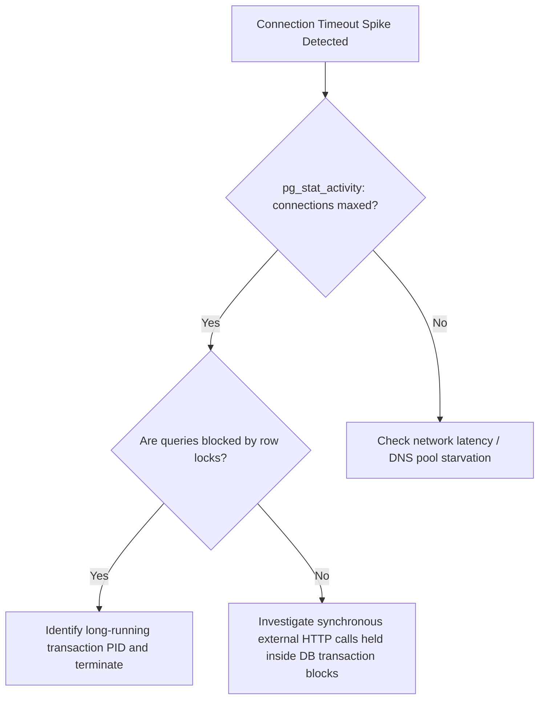

# RUNBOOK-DB-04: PostgreSQL Connection Pool Sizing and Saturation Remediation

| **Metadata** | **Value** |
| :--- | :--- |
| **Document ID** | RUNBOOK-DB-04 |
| **System** | Core Relational Data Layer (PostgreSQL) |
| **Owner** | Site Reliability Engineering (SRE) |
| **Severity Target** | HIGH / CRITICAL |
| **Last Verified** | November 2026 |

---

## 1. Trigger Symptoms & Error Signatures
- **Application Error:** `sqlalchemy.exc.TimeoutError: QueuePool limit of size 50 overflow 10 reached, connection timed out, timeout 30.00`
- **Error Signature:** `pg_conn_timeout:pool_exhausted`
- **Telemetry Indicators:** Upstream HTTP 504 Gateway Timeouts on `payment-gateway` and `order-api`.
- **Statistical Anomaly:** Error rate surges $\ge 3.5\sigma$ over 5-minute rolling window.

---

## 2. Immediate Triage & Diagnostic Steps

Execute the following read-only diagnostics to evaluate connection pool status:

```bash
# 1. Inspect active PostgreSQL connection counts and states
psql "$DATABASE_URL" -c "SELECT count(*), state, wait_event_type, wait_event FROM pg_stat_activity WHERE datname='tracemind' GROUP BY 1,2,3,4 ORDER BY 1 DESC;"

# 2. Check for long-running blocking transactions
psql "$DATABASE_URL" -c "SELECT pid, age(clock_timestamp(), query_start), usename, query FROM pg_stat_activity WHERE state != 'idle' AND query_start < now() - interval '30 seconds';"

# 3. Check memory & CPU saturation on worker instances
kubectl top pods -n production -l app=payment-gateway
```

---

## 3. Root Cause Analysis Flowchart



---

## 4. Emergency Mitigation Actions

1. **Scale Connection Pool Ceiling:**
   Adjust the application configuration environment variable:
   ```bash
   POSTGRES_POOL_SIZE=120
   POSTGRES_MAX_OVERFLOW=60
   ```
2. **Restart Saturated Pods Safely:**
   ```bash
   kubectl rollout restart deployment/payment-gateway -n production
   ```
3. **Enable Circuit Breaking:**
   Activate downstream circuit breaking to reject low-priority asynchronous requests while critical payment charges process.

---

## 5. Long-term Preventive Engineering
- Never invoke external network I/O or webhooks within open database transaction blocks (`async with db.begin():`).
- Implement PgBouncer transaction-level connection pooling between FastAPI microservices and PostgreSQL.
- Add Prometheus alerts for `pg_pool_active_connections / pg_pool_max_connections > 0.80` sustained for 2 minutes.
